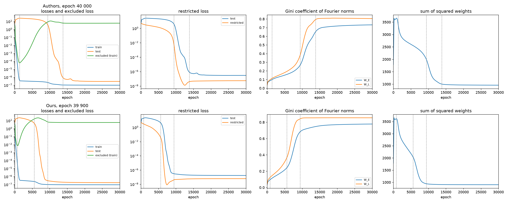
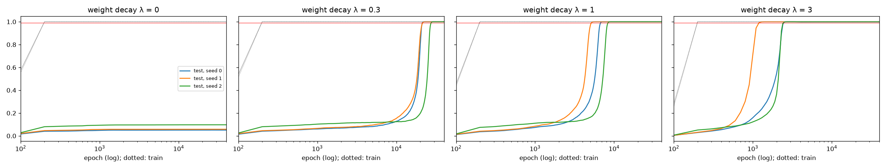

# Reproducing "Progress measures for grokking via mechanistic interpretability"

Nanda, Chan, Lieberum, Smith and Steinhardt, ICLR 2023: [arXiv 2301.05217](https://arxiv.org/abs/2301.05217). Authors' code: [progress-measures-paper](https://github.com/mechanistic-interpretability-grokking/progress-measures-paper).

## Result

We reproduced the paper along three lines: our analysis code run on the authors' published weights, the same analysis on a model we trained from scratch, and two sweeps (weight decay and training fraction). The success criteria, the key-frequency rule and the sweep hypotheses were fixed before we trained our model; they are collected in [docs/preregistration.md](docs/preregistration.md).

Grokking reproduces. With the paper's data and hyperparameters our model reaches 100% training accuracy by epoch 200 and exceeds 99% test accuracy at epoch 6 800. The paper reports the jump at "around 10 000 epochs"; in the authors' published trajectory the test loss drops below 10⁻³ at epoch 11 200, in ours at epoch 7 100.

The algorithm is the same. Our model also adds numbers by rotations on a circle (the Fourier multiplication algorithm of section 4), but it uses four key frequencies (4, 13, 25, 35) instead of the authors' five (14, 35, 41, 42, 52). The authors report 3 to 4 key frequencies on other seeds as well (appendix C.2.1). All four lines of evidence of section 4 hold on our model.

The three training phases reproduce. The authors placed the phase boundaries by eye. We defined them by three formal rules, calibrated on the authors' trajectory so that they recover the paper's boundaries: 1 400 / 9 400 / 13 800 epochs against the paper's 1 400 / 9 400 / 14 000. These are not the rules we pre-registered; the section on phases gives the reason and the result of the pre-registered rules. On our model the phases come in the same order and with the same behaviour of the progress measures, at roughly 0.6 of the authors' epochs: 800 / 5 600 / 9 400.

The role of weight decay is confirmed on 12 runs, λ ∈ {0, 0.3, 1, 3} with three seeds each. Without weight decay no seed generalises within 40 000 epochs. The stronger the weight decay, the earlier the jump: median 21 500, 6 800 and 2 500 epochs for λ = 0.3, 1 and 3, with non-overlapping ranges across seeds. The numbers in the text of appendix D.1 contradict the paper's own statement and figure 27; they agree with ours if the values for λ = 0.3 and λ = 3 are swapped, which suggests a typo.

The training-fraction experiment (appendix C.2.2) reproduces the qualitative picture: no generalisation within 40 000 epochs at 10% and 20% of pairs, grokking at 30% and 40%, and generalisation with a short delay from 60% up. Of our four pre-registered hypotheses, three were confirmed; the one that failed placed 50% in the grokking regime, where we see delays of only 600 to 1 000 epochs.

Not every number matches. On the authors' weights every structural claim matches exactly: the key frequencies, the 433 single-frequency neurons, the 44 neurons of frequency 14, table 1 to a tenth of a percent, and the section 4.4 ablation that keeps only the 40 key-frequency components of the logits (7.24·10⁻⁸, as in the paper). Three other ablation numbers of section 4.4 do not reproduce (replacing neurons by their frequency polynomial, the "strict" neuron ablation, and projecting onto the 10 directions of W_L), nor does the claim that projecting onto the null space of those directions gives a loss "worse than chance": we get 3.98 against the chance level of 4.73, although the network is broken either way.

## Comparison with the paper

The table is generated by `scripts/compare_with_paper.py` (output in [results/comparison.md](results/comparison.md)) from `results/*_snapshot.json`, `results/*_trajectory.csv` and the training log of our main run. The "match" columns apply the tolerances fixed in [docs/preregistration.md](docs/preregistration.md); a blank cell means no tolerance was fixed for that row.

| what | paper | authors' weights | our model | authors match | ours match |
|---|---|---|---|---|---|
| loss over all pairs, final checkpoint | 2.41e-7 | 2.41e-07 | 1.48e-07 | yes |  |
| 100% train accuracy, epoch | memorised by ~1 400 | — | 200 |  | yes |
| >99% test accuracy, epoch | ~10 000 | — | 6800 |  | yes |
| key frequencies (rule: >=10 neurons with FVE > 85%) | 14, 35, 41, 42, 52 | 14, 35, 41, 42, 52 | 4, 13, 25, 35 | yes | yes |
| frequencies with a large norm in W_E (>10 medians) | 6 | 6 | 5 | yes | yes |
| neuron 0: frequency | 42 | 42 | 13 | yes |  |
| head 0: attention frequency | 35 | 35 | 35 | yes |  |
| neurons with single-frequency FVE > 85% | 433 / 512 | 433 / 512 | 439 / 512 | yes | yes |
| neurons of frequency 14 | 44 | 44 | — | yes |  |
| W_L outside the cos/sin directions of key frequencies (share of squared norm) | < 0.55% | 0.55% | 0.21% | yes | yes |
| large 2D Fourier components of the logits (>30% of max) | 20 (4 per frequency) | 20 | 16 | yes | yes |
| table 1: FVE of u_k, v_k projections by one cos/sin(w(a+b)) term, minimum | 93.2% | 93.2% | 96.8% | yes | yes |
| logits ~ sum alpha_k cos(w_k(a+b-c)): fraction of variance | 95% | 96.1% | 97.9% | NO | yes |
|   ... loss of this approximation | 4.7e-8 | 4.4e-08 | 4.6e-08 |  |  |
| ablation: removing any key frequency from the logits raises the loss | yes | min 1.1e-03 | min 8.8e-03 | yes | yes |
| ablation: removing any non-key frequency barely changes the loss | yes | max 2.5e-07 | max 1.5e-07 | yes | yes |
| logits: keep only the 40 key-frequency components (4.4) | −70% (7.24e-8) | -70% (7.24e-08) | -42% (8.62e-08) | yes | yes |
| restricted loss (5.1): constant + cos/sin(w_k(a+b)) | — (fig. 7 only) | -77% (5.55e-08) | -63% (5.49e-08) |  |  |
| neurons with FVE > 85% replaced by their frequency polynomial | +3% (2.48e-7) | -37% | -2% |  |  |
| all neurons: keep only cos/sin(w_k(a+b)) of key frequencies | −77% (5.54e-8) | -67% | -40% |  |  |
| MLP activations projected onto the 10 W_L directions | −50% (1.19e-7) | -0% | +5% |  |  |
| ... onto their null space: loss | 5.27 (worse than chance, ln 113 = 4.73) | 3.98 | 4.17 | NO | NO |
| Gini W_E / W_L at the end | ~0.8 on fig. 7; 0.62–0.80 / 0.73–0.91 in table 5 | 0.74 / 0.80 | 0.78 / 0.85 |  |  |
| phases t1 / t2 / t3, epochs | 1 400 / 9 400 / 14 000 | 1400 / 9400 / 13800 | 800 / 5600 / 9400 | yes | yes |

The coefficients of table 1 match as well. For frequency 42 we get 66.6 for cos(w(a+b)) and 67.8 for sin(w(a+b)), as in the paper (`results/authors_snapshot.json`, field `table1`). Our Fourier basis is orthonormal, so the stored coefficients are divided by 113/√2, the norm of cos(w(a+b)) over the 113 × 113 grid, to put them on the paper's scale.

## Setup

### Task and data

The dataset is synthetic and complete: all 113 × 113 = 12 769 pairs (a, b) with a, b ∈ {0, …, 112} and the answer (a + b) mod 113. Each pair is fed as three tokens `a b =`, where `=` is a separate token with index 113, so the vocabulary has 114 tokens. The model answers at the `=` position.

30% of the pairs (3 830) are used for training and the remaining 70% (8 939) for testing. The split follows the authors exactly: the list of triples `(a, b, 113)` in a-major order is shuffled with the standard library `random.seed(0)` and `random.shuffle`, and the first 30% form the training set (`grokking.model.make_data`).

### Model and training

A one-layer transformer without LayerNorm: token embedding 114 × 128, positional embedding 3 × 128, four attention heads of dimension 32 with a causal mask, an MLP 128 → 512 → 128 with ReLU, and a separate unembedding 128 × 114, for 226 816 parameters in total. Training is full-batch with AdamW (learning rate 10⁻³, weight decay λ = 1 on every parameter, betas 0.9 / 0.98, linear warm-up over 10 steps) for 40 000 epochs. The loss is the cross-entropy at the `=` position over all 114 logits. All of this was checked line by line against the authors' `transformers.py` and `helpers.py`. The forward pass runs in float32 on the Apple M4 GPU (MPS); the cross-entropy is computed in float64 on the CPU, because in float32 losses below about 10⁻⁷ cannot be told apart and training shows loss spikes. The main run takes 12.5 minutes. Training on MPS is not bit-reproducible: two runs of the same configuration give slightly different curves. This is why λ = 1, 30% data, seeds 1 and 2 appear as 5 200 / 8 400 epochs in the weight decay table and as 5 300 / 8 500 in the training-fraction table: these are separate runs.

The authors did not seed their initialisation, so their exact run cannot be repeated. We initialise the same way (N(0, 1/128) for the weight matrices, N(0, 1/114) for W_U, zero biases), with our own generator and `init_seed = 0`.

### Verification against the authors' trajectory

The authors published their full training run, `grokking_addition_full_run.pth` (456 MB): weights every 100 epochs (500 checkpoints, epochs 0 to 49 900), the training loss at every epoch and the test loss every 10 epochs. The run is 50 000 epochs long, not 40 000 as stated in the paper. The analysis of section 4 uses the checkpoint at epoch 40 000 (`state_dicts[400]` in the authors' `Grokking_Analysis.ipynb`).

We checked our code in three directions.

1. Our model code reproduces the authors' recorded losses on their weights, which tests the architecture, the weight conversion and the data split together. We load 13 of their checkpoints (epochs 0 to 49 900) into our model, compute the loss on our training pairs and compare it with the loss they recorded. The worst relative discrepancy is 2.9·10⁻⁷ (the test asserts below 10⁻⁶, the pre-registered tolerance); with a different split the losses would differ by orders of magnitude (`tests/test_authors_trajectory.py`).
2. Our analysis code on the authors' weights reproduces the paper's numbers, which tests the analysis (`scripts/analyze.py snapshot authors`, the "authors' weights" column above).
3. The same code on our model shows the same phenomenon, which is the reproduction proper (`scripts/analyze.py snapshot seed0`).

The loss of the authors' epoch-40 000 checkpoint over all 12 769 pairs is 2.412·10⁻⁷, exactly the "2.41·10⁻⁷" of section 4.4. From this we conclude that the losses in section 4 are computed over all pairs, not over the test pairs only, and we compute them the same way.

Key frequencies are chosen by a fixed rule: a frequency is key if at least 10 neurons have more than 85% of their variance explained by it. On the authors' weights the rule gives exactly 14, 35, 41, 42 and 52, so we applied it to our model unchanged. The frequencies are determined on the final checkpoint and then used for every checkpoint of the trajectory.

## Mechanism

The algorithm the paper reads from the weights maps a to the pairs cos(w_k a), sin(w_k a) for a few frequencies w_k = 2πk/113, combines a and b through attention and the MLP into cos(w_k(a+b)) and sin(w_k(a+b)), and produces for each candidate c a logit proportional to cos(w_k(a+b−c)), which peaks at c = (a+b) mod 113. The paper supports this with four lines of evidence, and each of them holds on both models.

The embedding is sparse in the Fourier basis (figure 3). The authors' W_E has six frequencies with a norm above ten times the median, five of which are key; ours has five. The Fourier norms of W_L are concentrated on the key frequencies in both models.

Attention heads and MLP neurons are periodic in the input (figures 4 and 5). Head 0 works at frequency 35 in both models; neuron 0 is at frequency 42 in the authors' model and 13 in ours. A single frequency explains more than 85% of the variance of 433 of 512 neurons in the authors' model and 439 of 512 in ours. Projecting the directions u_k, v_k of W_L onto a single cos(w(a+b)) or sin(w(a+b)) term explains at least 93.2% of their variance in the authors' model (table 1) and 96.8% in ours.

The logits are close to a sum of cos(w_k(a+b−c)) over the key frequencies. The 2D Fourier transform of the logits has 20 large components (4 per frequency) in the authors' model and 16 in ours. The cosine fit explains 96.1% of the logit variance on the authors' weights (95% in the paper) and 97.9% on ours. W_L lies almost entirely in the span of the cos/sin directions of the key frequencies: 0.55% of its squared norm is outside for the authors, 0.21% for us.

Ablations agree with the algorithm (figure 6). Removing any one key frequency from the logits raises the loss to at least 1.1·10⁻³ on the authors' weights and 8.8·10⁻³ on ours, against a final loss of order 10⁻⁷; removing any non-key frequency leaves it at most 2.5·10⁻⁷ and 1.5·10⁻⁷ respectively. Keeping only the 40 key-frequency components of the logits lowers the loss by 70% on the authors' weights and by 42% on ours.


### What did not match

The share of W_L outside the key directions. Taken literally as a ratio of norms, the residual is 7.4%. As a ratio of squared norms it is 0.552%, which matches "under 0.55%" up to rounding. Centring and the spectral norm, tried in exploratory runs, give nothing similar (7.4% and 9.8%). The paper most likely meant squared norms, but we cannot confirm this.

The fraction of logit variance explained by the cosine fit is 96.1% instead of 95%. Three centring variants, tried in exploratory runs, give 96.1 to 96.3%. The difference is one percentage point and does not change the conclusion that the key-frequency cosines explain almost all of the logits.

The ablations of section 4.4. The logit ablation matches exactly: zeroing all 113 × 113 2D Fourier components except 40 (8 per key frequency, the block {const, cos k, sin k}² without the constant) gives a loss of 7.236·10⁻⁸ against the paper's 7.24·10⁻⁸. The other three ablations do not match under any of the roughly 30 interpretations we tried in exploratory runs that are not part of this repository; `scripts/analyze.py` computes the direct interpretation of each: only the 433 single-frequency neurons or all 512; the full polynomial or only the a+b terms; with and without centring; with and without b_out; 113 or 114 logits; training, test or all pairs.

- Replacing the 433 neurons by their frequency polynomial: +3% (2.48·10⁻⁷) in the paper, between −37% and −55% for us. The replacement does not hurt in either case, but the sign differs.
- The "strict" neuron ablation, keeping only cos/sin(w_k(a+b)) of the key frequencies: 5.54·10⁻⁸ in the paper, 7.86·10⁻⁸ for us.
- Projecting the MLP activations onto the 10 directions of W_L: −50% (1.19·10⁻⁷) in the paper, 2.38 to 2.58·10⁻⁷ for us under all variants, that is, no change on the authors' weights (and +5% on our model). The conclusion that these directions suffice holds; the claim that the projection improves the loss does not.

Two coincidences may explain the confusion but do not prove it: 5.54·10⁻⁸ equals our restricted loss of section 5.1 (5.547·10⁻⁸), and 2.48·10⁻⁷ equals our largest loss after removing a single non-key frequency (2.476·10⁻⁷). We did not find the code for the section 4.4 ablations in the authors' repository (`Grokking_Analysis.ipynb`, `transformers.py`, `helpers.py`), so we cannot check how they were computed.

The null space of W_L. The paper reports a loss of 5.27, "worse than chance", after projecting the MLP output onto the null space of the 10 directions. Our direct interpretation (the neuron activations minus their projection onto the 10 directions u_k, v_k) gives 3.98 on the authors' weights and 4.17 on ours. The network is broken completely, with a loss 10⁷ times above the original, but it is formally better than uniform guessing (ln 113 = 4.73). Other interpretations, again exploratory, give 3.80 to 5.11. The closest (5.11 on all pairs, 5.24 on the test pairs) subtracts the cos/sin(w_k(a+b)) components from the neuron activations, which is a different ablation. The conclusion that the network achieves a low loss only through these directions holds; the exact number and "worse than chance" do not.

## Progress measures and phases

Knowing the algorithm, the paper defines two progress measures. The restricted loss keeps only the constant and the cos(w_k(a+b)), sin(w_k(a+b)) terms of the key frequencies in the 2D Fourier decomposition of the logits; it is low once the generalising circuit is in place. The excluded loss removes exactly these terms and evaluates the training loss; it rises when the network stops relying on memorisation. Alongside them the paper tracks the Gini coefficient of the Fourier norms of W_E and W_L (Hurley and Rickard 2009), which measures how concentrated the weights are on few frequencies, and the sum of squared weights. We compute the restricted loss over all 12 769 pairs and the excluded loss on the training pairs with all key frequencies removed at once, as in the authors' notebook.

We compute these measures at every 100 epochs of both trajectories (`scripts/analyze.py trajectory`; 401 points for the authors up to epoch 40 000, 400 points for us up to epoch 39 900) and place the phase boundaries with the rules in `grokking/phases.py`:

- t1, end of memorisation: the epoch of the minimum of the excluded loss;
- t2, start of cleanup: the first epoch with test loss below ln 113, that is, better than chance;
- t3, end of cleanup: the first epoch at which the sum of squared weights is at most 1.05 times its final value.



These rules differ from the pre-registered ones. The plan fixed t_excl (the excluded loss exceeds its minimum by a factor k), t_restr (the restricted loss falls below a fraction q of its initial value) and t_test (the test loss falls below 10⁻³), with k and q to be calibrated on the authors' trajectory. We replaced them because they cannot reproduce the paper's boundaries: t_test gives 11 200 rather than 14 000 on the authors' trajectory, and for any k > 1 t_excl lies after the minimum. The new rules were calibrated only on the authors' trajectory, but `phases.py` was written after our model's trajectory had already been computed; of that trajectory we had seen only the log lines for epochs 0 and 5 000. As a check (`scripts/extra_checks.py`) we report the pre-registered rules with k = 1.1 and q = 1.6·10⁻³ (calibrated on the authors' trajectory to give 1 400 and 9 400): they give 1 600 / 9 400 / 11 200 for the authors and 1 000 / 6 100 / 7 100 for us. The order and the ratio (our epochs about 0.6 of the authors') are the same.

The criterion t1 < t2 < t3 on its own is weak: almost any run that groks will satisfy it. The t3 threshold is also sensitive: 1.02 instead of 1.05 gives 16 100 on the authors' trajectory, 1.1 gives 13 000. The informative part is what the progress measures do between the boundaries. At t2 the test accuracy is 51% for the authors and 47% for us (`scripts/extra_checks.py`), so the rule marks the same point of the jump in both models.

| measure | authors: 0 / t1 / t2 / t3 | ours: 0 / t1 / t2 / t3 |
|---|---|---|
| epoch | 0 / 1 400 / 9 400 / 13 800 | 0 / 800 / 5 600 / 9 400 |
| train loss | 4.76 / 3.9e-7 / 2.2e-7 / 1.1e-7 | 4.77 / 3.1e-5 / 2.4e-7 / 9.9e-8 |
| test loss | 4.76 / 26 / 4.15 / 8.7e-7 | 4.77 / 20 / 4.62 / 3.1e-7 |
| excluded loss (train) | 4.76 / 6.2e-5 / 8.6 / 6.2 | 4.77 / 7.2e-3 / 16 / 6.9 |
| restricted loss | 4.76 / 2.97 / 7.2e-3 / 4.0e-8 | 4.76 / 3.04 / 4.1e-2 / 4.2e-8 |
| Gini W_L | 0.03 / 0.11 / 0.38 / 0.79 | 0.04 / 0.12 / 0.36 / 0.84 |
| sum of squared weights | 1 783 / 3 370 / 2 000 / 1 000 | 1 783 / 3 620 / 2 040 / 940 |

The picture is the same in both models. During memorisation the training loss and the excluded loss fall while the test loss rises. During circuit formation the excluded loss rises by three to five orders of magnitude, the restricted loss falls from about 3 to 10⁻² to 10⁻³, and the sum of squared weights almost halves, while the training loss stays flat. During cleanup the test loss collapses, the Gini coefficient rises sharply, and the weights halve again.

Our model differs in two respects. Its excluded loss reaches its minimum at epoch 800, when the training loss is still 3·10⁻⁵, so the circuit starts forming before memorisation is complete. And during circuit formation its test loss falls noticeably (20 to 4.6, with test accuracy rising from 6.7% to 47%), while the authors' falls less (26 to 4.2, which is also not perfectly flat).

## Weight decay sweep

The paper states that without weight decay there is no grokking and that weaker weight decay delays it. We pre-registered the direction of the effect before our first training run: no jump within 40 000 epochs at λ = 0, and a later jump at λ = 0.3 than at λ = 1, and at λ = 1 than at λ = 3. The metric is the first epoch with test accuracy above 99%. Each λ is trained with three initialisation seeds (0, 1, 2) on the same data split.

The hypothesis is confirmed, and the order holds for every seed, not only for the median ([results/sweep.md](results/sweep.md)).

| λ | seed 0 | seed 1 | seed 2 | median |
|---|---|---|---|---|
| 0 | > 40 000 | > 40 000 | > 40 000 | > 40 000 |
| 0.3 | 21 400 | 21 500 | 27 500 | 21 500 |
| 1 | 6 800 | 5 200 | 8 400 | 6 800 |
| 3 | 2 500 | 1 200 | 2 500 | 2 500 |



The seed ranges do not overlap: 21 000 to 28 000 epochs at λ = 0.3, 5 000 to 8 500 at λ = 1, 1 000 to 2 500 at λ = 3. Memorisation barely depends on λ: metrics are logged every 100 epochs, and by epoch 200 all 12 runs have 100% training accuracy. What depends on λ is how long the jump takes after memorisation.

Without weight decay the network stays in the memorising solution. Its test accuracy never exceeds 5 to 10% within 40 000 epochs (chance is 0.9%). The test loss ends at 52 to 53 and is still rising: the network becomes more and more confident in its wrong answers.

The sum of squared weights shows why. With weight decay it first grows (to about 2 900 at λ = 3, 3 650 at λ = 1 and 4 300 at λ = 0.3) and then falls to about 900. Without weight decay it only grows, from 1 780 to 5 500. This agrees with the paper's explanation: the penalty makes memorisation expensive, and the memorising weights are swept away during cleanup.

The numbers of appendix D.1 read "≈3k epochs at λ = 0.3, 5–10k at λ = 1, 20k at λ = 3". We get 21.5k at λ = 0.3, 6.8k at λ = 1 and 2.5k at λ = 3. The value for λ = 1 agrees, and the two extremes agree if they are swapped: "3k" resembles our λ = 3 and "20k" our λ = 0.3. The sentence in D.1 itself ("smaller weight decay leads to slower grokking") and the caption of figure 27 say the same. Most likely the λ values in the text are transposed. We do not have the authors' runs for these λ, so this is an inference from agreement, not a direct check.

One run (λ = 3, seed 0) settles after the jump at 99.8 to 99.9% test accuracy with a final test loss of 6.7·10⁻³, while the other two λ = 3 seeds end at 7·10⁻⁷ and 1.7·10⁻⁵; it still passes the 99% threshold. We did not test dropout instead of weight decay, which D.1 also discusses.

## Training-fraction experiment

We repeated appendix C.2.2 (figures 20 and 21): training fractions 0.1 to 0.9, three seeds each, λ = 1. The hypotheses and metrics were written down before the runs ([docs/preregistration.md](docs/preregistration.md)). The run with fraction 0.3 and seed 0 is our main model, which was already known; at 30% only seeds 1 and 2 were run blind. The metric t_test is the first epoch with test accuracy above 99%; the delay is t_test minus the first epoch with 100% training accuracy. Runs stopped early once the test loss fell below 10⁻⁶, which does not affect t_test or the delay. The per-run table is in [results/data_fraction.md](results/data_fraction.md).

| fraction | 0.1 | 0.2 | 0.3 | 0.4 | 0.5 | 0.6 | 0.7 | 0.8 | 0.9 |
|---|---|---|---|---|---|---|---|---|---|
| t_test, median of three | > 40 000 | > 40 000 | 6 800 | 1 600 | 1 100 | 600 | 500 | 300 | 200 |
| delay, range over seeds | — | — | 5 100–8 300 | 1 400–1 900 | 600–1 000 | 400 | 300 | 100–200 | 0 |

A delay of 0 at 90% means that both events fall into the same 100-epoch logging interval.


Memorisation does not depend on the fraction: at every fraction the training accuracy is 100% by epoch 200. As in figure 21 of the paper, the training loss drops below 10⁻⁶ at almost the same time for all fractions (epochs 1 000 to 1 200), while the test loss does so later the less data there is: from epochs 1 000 to 1 100 at 90% to 6 400 to 9 500 at 30%.

The four hypotheses:

1. At 10% and 20% no seed generalises within 40 000 epochs. Confirmed. At 10% the model is even worse than chance: the final test accuracy is 0.28 to 0.44% against 0.88% for guessing, and the test loss rises to 53 to 55.
2. At 30 to 50% every seed groks, with a delay of at least 1 000 epochs. Not confirmed, because of the 0.5 fraction: its delays are 1 000, 900 and 600 epochs. At 30% and 40% the hypothesis holds.
3. The less data, the later the jump (median t_test 0.3 > 0.4 > 0.5). Confirmed.
4. At 60 to 90% the model generalises "immediately", with a delay below 1 000 epochs. Confirmed.

The boundary between "grokking" and "generalises immediately" depends on the threshold. The paper counts 50% as grokking; for us the delay at 50% is 600 to 1 000 epochs, close to the 400 at 60%. At the low end, however, the change is abrupt: from 20% to 30% the model goes from no generalisation within 40 000 epochs to a delay of 5 100 to 8 300 epochs, and from 30% to 40% the median delay drops by a factor of 4.7.

At 20% the runs are not static at epoch 40 000. The test loss falls slowly for all three seeds (from about 31 at epoch 10 000 to 25.8, 20.8 and 14.5 at epoch 39 900), and the final test accuracy is 2.6, 5.6 and 13.0%. For seed 2 it grows from 3.9% at epoch 30 000 to 13%. Grokking at 20% may be possible but later than 40 000 epochs. We did not test this, since we did not train beyond 40 000 epochs.

Our numbers do not support the explanation that at small fractions memorisation is cheaper than the algorithm (Varma et al. 2023). The model trained on 30% of the pairs that generalised (seed 0, epoch 39 900) has a sum of squared weights of 896 and a training loss of 9·10⁻⁸. The 10% training pairs are a subset of the 30% ones (the same shuffled list), and on these 1 276 pairs its loss is 9.1·10⁻⁸ (`scripts/extra_checks.py`), so it solves the 10% task more accurately than the models trained on it. The models trained on 10% that stayed in memorisation weigh 1 330 to 1 342 at epoch 39 900, with a training loss of 1.5·10⁻⁷. A lighter solution to the 10% task therefore exists, but AdamW with weight decay did not reach it within 40 000 epochs. The issue appears to be whether training finds the solution rather than the relative cost of the solutions. The caveats are that the generalising model is a single seed and that the sum of squared weights is a crude measure of cost.

## Discrepancies between the paper and the authors' code

- Training length: the paper states 40 000 epochs; the published trajectory is 50 000 epochs long. The analysis uses the checkpoint at epoch 40 000.
- Loss precision: in `helpers.py`, `cross_entropy_high_precision` casts the logits to float32, although its comment speaks of float64. The authors' recorded losses go below 1.2·10⁻⁷, which is impossible in float32, so the published trajectory itself must have been trained with float64 losses.
- Key frequencies: `calculate_key_freqs` iterates over `range(1, p//2)`, which skips frequency 56, and it returns every frequency that is the best one for at least one neuron, without any threshold. Our rule iterates over 1 to 56 and uses the threshold described above.
- Gini coefficient: section 5.2 mentions the Gini coefficient of "W_U and W_L", while section 5.1 and figure 7 use W_E and W_L. We compute it for W_E.
- Excluded loss: the paper and the notebook remove all key frequencies at once (`excluded_loss_2D_full`); `transformers.py` removes them one at a time. We use all at once.
- Appendix D.1 states that smaller weight decay leads to slower grokking, but then gives "≈3k epochs at λ = 0.3 and 20k at λ = 3", which contradicts the sentence and the caption of figure 27. Our sweep agrees with the λ = 0.3 and λ = 3 values being swapped (see the weight decay sweep above).

## Limitations

- The authors' initialisation is not seeded, so their run cannot be replicated exactly. Exact numbers are compared on their weights; the phenomenon is compared on our model, which has different key frequencies and phase boundaries.
- The mechanistic analysis of our own model rests on one seed. The sweeps use three seeds per setting and a single data split; with three points per setting we report medians and ranges and no significance tests.
- The phase-boundary rules were changed from the pre-registered ones after our trajectory had been computed, as described above. The pre-registered rules, applied for comparison, give the same order and ratio.
- The sweep metric is the 99% test-accuracy threshold, not the end of the cleanup phase.
- At 30% training data, seed 0 is the main run and was known before the training-fraction hypotheses were written.
- We did not train beyond 40 000 epochs, so we cannot say whether 20% of the data groks later.
- We could not find the code behind the section 4.4 ablations, so the mismatches there may come from a different definition rather than a different result.
- We did not test dropout or other regularisers.

## Repository layout

- `grokking/` is the package.
  - `model.py`: data split, model, weight conversion from the authors' format (`load_authors`), loss and training loop.
  - `fourier.py`: the Fourier basis and every measurement of sections 4 and 5 (float64, CPU, all 12 769 pairs).
  - `measure.py`: the section 4 snapshot of one model and the progress measures over a trajectory.
  - `phases.py`: the phase-boundary rules.
  - `weights.py`: loading the authors' trajectory and our checkpoints.
  - `curves.py`: training curves, ours and the authors'.
  - `sweeps.py`: the two sweep grids and their run names.
  - `paths.py`: every file location in one place.
- `scripts/` holds the command-line entry points: `train.py`, `analyze.py`, `compare_with_paper.py`, `figures.py`, `summarize_wd_sweep.py`, `summarize_data_fraction.py`, `extra_checks.py`, and `sweep.sh` for both grids (`wd` or `frac`).
- `tests/`: pytest suite, including the check of our code against the authors' recorded losses.
- `results/`: snapshots (`*_snapshot.json`), trajectories of the progress measures (`*_trajectory.csv`), and the tables `comparison.md`, `sweep.md` and `data_fraction.md`.
- `figures/`: report figures, numbered after the corresponding figures of the paper.
- `docs/preregistration.md`: what was fixed before our model was trained.
- `data/` (authors' file and caches) and `runs/` (our training runs) are not under version control.

Figures:

- `fig2_curves.png`: training curves, ours and the authors'.
- `fig3_fourier_norms.png`: Fourier norms of W_E and W_L, with a few large bars at the key frequencies and the rest near zero.
- `fig4_periodicity.png`: attention of head 0 and activation of neuron 0 over all pairs (a, b), and the 2D Fourier norms of the logits, with 2 × 2 blocks at the key frequencies.
- `fig5_neuron_fve.png`: how many neurons have more than 85% of their variance explained by a single frequency.
- `fig6_ablations.png`: loss after removing each frequency from the logits.
- `fig7_progress.png`: progress measures over training with the phase boundaries.
- `fig_wd_sweep.png`: the weight decay sweep.
- `fig_data_fraction.png`: the training-fraction sweep.

## How to reproduce

```bash
uv sync                                         # environment from uv.lock

# the authors' trajectory (456 MB) into data/authors/
mkdir -p data/authors
uv run gdown 12pmgxpTHLDzSNMbMCuAMXP1lE_XiCQRy -O data/authors/grokking_addition_full_run.pth

uv run pytest                                   # includes our code against the authors' recorded losses

uv run python scripts/train.py --name seed0     # main run, about 13 min on an Apple M4
uv run python scripts/analyze.py snapshot authors
uv run python scripts/analyze.py snapshot seed0
uv run python scripts/analyze.py trajectory authors
uv run python scripts/analyze.py trajectory seed0
uv run python scripts/compare_with_paper.py     # -> results/comparison.md
uv run python scripts/figures.py                # figures 2-7 -> figures/

scripts/sweep.sh wd                             # 11 runs, metrics only (about 3 h); seed 0 at λ = 1 is runs/seed0
uv run python scripts/summarize_wd_sweep.py     # -> results/sweep.md
scripts/sweep.sh frac                           # 26 runs, early stop at test loss 1e-6
uv run python scripts/summarize_data_fraction.py   # -> results/data_fraction.md
uv run python scripts/figures.py sweeps         # fig_wd_sweep.png, fig_data_fraction.png
uv run python scripts/extra_checks.py           # further numbers quoted below
```

The file ID above is the one the authors' `helpers.py` passes to `gdown` in `download_model_from_drive`. If it stops working, take the current link from the authors' repository README. The copy we used is 456 428 905 bytes. It is a pickle and is loaded with `torch.load(..., weights_only=True)`. Several copies of `sweep.sh` can run in parallel: each run is claimed by creating `runs/.claims/<name>`, and claimed or existing runs are skipped.

## References

- N. Nanda, L. Chan, T. Lieberum, J. Smith, J. Steinhardt. Progress measures for grokking via mechanistic interpretability. ICLR 2023. [arXiv 2301.05217](https://arxiv.org/abs/2301.05217).
- Authors' code and trajectory: [github.com/mechanistic-interpretability-grokking/progress-measures-paper](https://github.com/mechanistic-interpretability-grokking/progress-measures-paper).
- A. Power, Y. Burda, H. Edwards, I. Babuschkin, V. Misra. Grokking: generalization beyond overfitting on small algorithmic datasets. 2022. [arXiv 2201.02177](https://arxiv.org/abs/2201.02177).
- V. Varma, R. Shah, Z. Kenton, J. Kramár, R. Kumar. Explaining grokking through circuit efficiency. 2023. [arXiv 2309.02390](https://arxiv.org/abs/2309.02390).
- N. Hurley, S. Rickard. Comparing measures of sparsity. IEEE Transactions on Information Theory 55(10), 2009.
