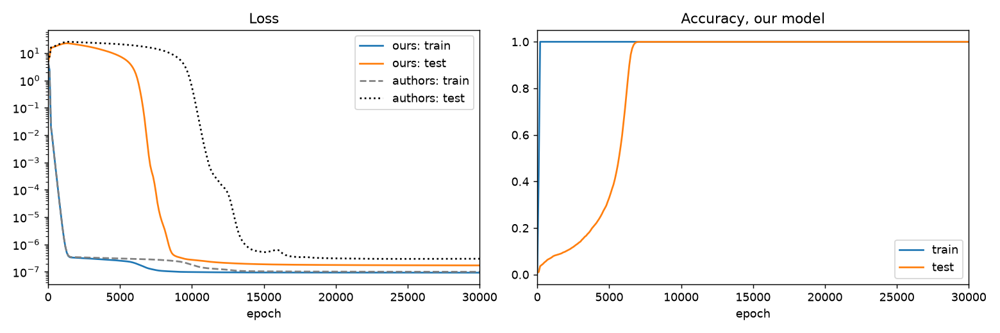
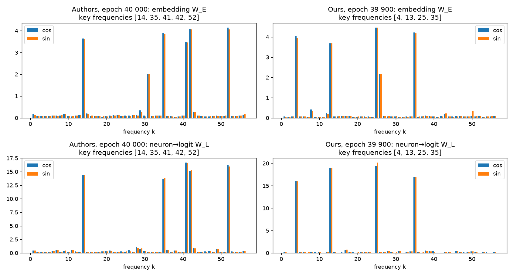
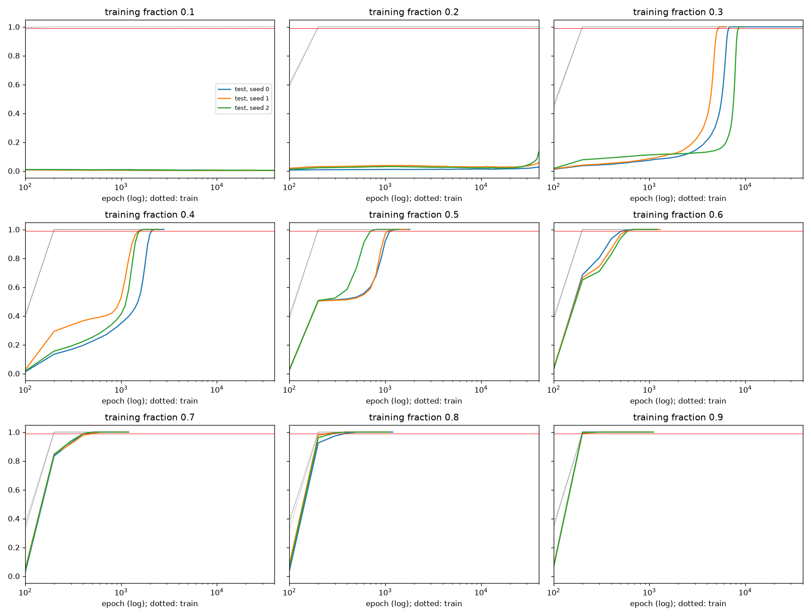

# Grokking: a reproduction of Nanda et al. 2023 and an early edit that shortens it

Nanda, Chan, Lieberum, Smith and Steinhardt, ICLR 2023: [arXiv 2301.05217](https://arxiv.org/abs/2301.05217). Authors' code: [progress-measures-paper](https://github.com/mechanistic-interpretability-grokking/progress-measures-paper).

## Main result

In the setup of Nanda et al. (2023), grokking can be shortened about 18-fold by one edit early in training. At epoch 100, thousands of epochs before the jump, we replace the number embeddings W_E by their projection onto the 4 frequencies that are largest in W_E at that moment, and train on. In 5 of 5 initialisations the model then reaches 99% test accuracy a median 18 times sooner. Most of this comes from projecting onto a few Fourier frequencies at all: 4 random frequencies, rescaled to the same norm and applied to the same saved state, give a median factor of 10.9. The model's own early choice adds a median factor of 1.59 on top (faster in 5 of 5, range 1.10 to 1.80). Both experiments were pre-registered; the second, with random frequencies of equal norm, was written after the first, when the runs without the edit and with the model's own frequencies were already known, so only the random-frequency runs were new.

| init | no change | own 4 frequencies | random 4, equal norm |
|---|---|---|---|
| 0 | 6 660 | 370 | 610 |
| 1 | 5 100 | 440 | 700 |
| 2 | 8 100 | 390 | 500 |
| 3 | 8 590 | 460 | 830 |
| 4 | 8 150 | 490 | 540 |

*First epoch with test accuracy above 99%; all three runs of a row continue from one saved state at epoch 100.*

In the logits, the projected models end up as the normal ones do, and get there in the same order, only faster and with a much shorter memorisation phase. On their final weights, keeping only the key-frequency terms cos/sin(w_k(a+b)) of the logits leaves the loss as low as that of the full model, and removing them raises the training loss to 5.9 to 27.6. As in normal training, this restricted loss falls before the test loss: below 0.1 at epochs 170 to 230 with the model's own frequencies and 240 to 500 with random ones, against 3 800 to 7 400 without the edit. Unlike normal training, the fit of the training pairs depends on the key-frequency terms early: at epoch 200, removing them raises the training loss to 5 to 11 after the edit, but only to 0.06 to 0.10 without it.

**Conditions.** Task a + b mod 113; the paper's one-layer transformer (226 816 parameters) and split (30% of the pairs for training); AdamW with learning rate 10⁻³ and weight decay 1, full batch, CPU. Five initialisation seeds. The edit happens once, at epoch 100. W_E[:113] is projected onto the constant and the cos/sin of 4 frequencies, chosen as the 4 largest in W_E at that epoch, with no knowledge of the final model. The random control takes 4 other frequencies and rescales the result to the same norm. The metric is the first epoch with test accuracy above 99%, checked every 10 epochs.

**What remains uncertain.**

- The logit scale. The projection shrinks W_E to about a third of its norm, and the logits with it. Shrinking W_E by the same factor without the projection gives only 1.2×, but no control holds the logit scale equal to that after the projection. Part of the speed-up may therefore be an effect of output temperature rather than of the Fourier support.
- Generality. Five initialisations, one data split, one task and model, one edit epoch and one number of frequencies. Nothing was tested beyond this setup.
- Fourier or just low rank. The claim that most of the speed-up comes from the Fourier projection lacks a one-off control onto a non-Fourier subspace of the same dimension and norm. The only low-rank controls are single pilot runs with the projection re-applied after every step, and those never grokked.
- Novelty. That a Fourier embedding on arbitrary frequencies speeds training up has a precedent: in section 2.1 of GrokTransfer a fixed Fourier embedding on frequencies that are not the model's own removes the delay. What we add is the choice made inside the run at epoch 100, and the comparison of own and random frequencies of equal norm from one state. We found no work that does this, which is a search result, not proof.
- Why the model's own frequencies are faster we do not know. Under a projection re-applied after every step, random frequencies were sometimes more than twice as fast as the model's own.

## Reproduction in brief

- **Grokking and its mechanism reproduce.** Trained from scratch, our model memorises by epoch 200 and generalises (>99% test accuracy) at epoch 6 800, using the same Fourier multiplication algorithm with 4 key frequencies instead of the authors' 5.
- **On the authors' own weights our analysis gives the paper's numbers** (key frequencies, 433 single-frequency neurons, table 1). Five numbers do not reproduce: three ablations of section 4.4, the null-space loss and the cosine-fit share (96.1% against 95%), cause unknown.
- **Weight decay sets the delay.** No seed generalises without it; the median jump comes at 21 500, 6 800 and 2 500 epochs for λ = 0.3, 1 and 3 (three seeds each). The numbers in appendix D.1 appear to have the values for λ = 0.3 and 3 swapped. Paper and code also disagree in a few checkable places: the run is 50 000 epochs, not 40 000, and frequency 56 is never considered.
- **Which frequencies a model uses is visible in the embedding long before the jump; the neurons commit to them only around the jump.** In 19 new models the final key frequencies are all among the 9 largest of 56 frequencies of the embedding by epoch 500, while the test jump comes at 3 400 to 11 100. The paper's split appears to favour some frequencies: in a pre-registered test, frequency 7 was a key frequency in 3 of 8 new seeds, against about 1.5% probability if all frequencies were equally likely.



*Left: train and test loss, ours (solid) and from the authors' published run (dashed, dotted). Right: accuracy of our model.*

## All results

We reproduced the paper along three lines: our analysis code run on the authors' published weights, the same analysis on a model we trained from scratch, and two sweeps (weight decay and training fraction). We then went beyond the paper: how the key frequencies are chosen across seeds and over training, and whether that choice can be used to speed grokking up. The success criteria, the key-frequency rule and the sweep hypotheses were fixed before we trained our model; they are collected in [docs/preregistration.md](docs/preregistration.md).

Grokking reproduces. With the paper's data and hyperparameters our model reaches 100% training accuracy by epoch 200 and exceeds 99% test accuracy at epoch 6 800. The paper reports the jump at "around 10 000 epochs"; in the authors' published trajectory the test loss drops below 10⁻³ at epoch 11 200, in ours at epoch 7 100.

The algorithm is the same. Our model also adds numbers by rotations on a circle (the Fourier multiplication algorithm of section 4), but it uses four key frequencies (4, 13, 25, 35) instead of the authors' five (14, 35, 41, 42, 52). The authors report 3 to 4 key frequencies on other seeds as well (appendix C.2.1). All four lines of evidence of section 4 hold on our model.

The three training phases reproduce. The authors placed the phase boundaries by eye. We defined them by three formal rules, calibrated on the authors' trajectory so that they recover the paper's boundaries: 1 400 / 9 400 / 13 800 epochs against the paper's 1 400 / 9 400 / 14 000. These are not the rules we pre-registered; the section on phases gives the reason and the result of the pre-registered rules. On our model the phases come in the same order and with the same behaviour of the progress measures, at roughly 0.6 of the authors' epochs: 800 / 5 600 / 9 400.

The role of weight decay is confirmed on 12 runs, λ ∈ {0, 0.3, 1, 3} with three seeds each. Without weight decay no seed generalises within 40 000 epochs. The stronger the weight decay, the earlier the jump: median 21 500, 6 800 and 2 500 epochs for λ = 0.3, 1 and 3, with non-overlapping ranges across seeds. The numbers in the text of appendix D.1 contradict the paper's own statement and figure 27; they agree with ours if the values for λ = 0.3 and λ = 3 are swapped, which suggests a typo.

The training-fraction experiment (appendix C.2.2) reproduces the qualitative picture: no generalisation within 40 000 epochs at 10% and 20% of pairs, grokking at 30% and 40%, and generalisation with a short delay from 60% up. Of our four pre-registered hypotheses, three were confirmed; the one that failed placed 50% in the grokking regime, where we see delays of only 600 to 1 000 epochs.

Across 19 further models with different initialisation and data seeds, every run grokked, with 3 to 5 key frequencies (4 in 11 of 16 initialisations on the paper's split). The frequencies are chosen early: at epoch 500 every final key frequency is already among the 9 largest frequencies of the embedding, while the test jump comes at 3 400 to 11 100 epochs. The paper's split appears to favour particular frequencies, most of all 7, and a run with every number renamed confirms that our code treats all numbers alike. If the preference is real, it therefore comes from the data; which property of the split causes it we have not found.

Exploratory measurements on the saved weights add a time line. The frequencies stand out in the embedding early (in the main model by epoch 60, from an almost flat start; in most runs well before the jump), but neurons commit to single frequencies only around the test jump; in some runs an extra frequency becomes key for a while and is then removed, as in the paper's cleanup phase. The initial state predicts the winners only in part: a per-neuron lottery in the style of He et al. (2026) barely beats chance, and the best whole-model score puts about half of the final key frequencies among the top 10 of 56.

The early choice can be used: projecting the embedding at epoch 100 onto a few of its frequencies shortens grokking (see the main result above and the two sections on the projection). Four of the six hypotheses of the first projection experiment held and both of the second.

Not every number matches. On the authors' weights every structural claim matches exactly: the key frequencies, the 433 single-frequency neurons, the 44 neurons of frequency 14, table 1 to a tenth of a percent, and the section 4.4 ablation that keeps only the 40 key-frequency components of the logits (7.24·10⁻⁸, as in the paper). Three other ablation numbers of section 4.4 do not reproduce (replacing neurons by their frequency polynomial, the "strict" neuron ablation, and projecting onto the 10 directions of W_L), nor does the claim that projecting onto the null space of those directions gives a loss "worse than chance": we get 3.98 against the chance level of 4.73, although the network is broken either way.

## Comparison with the paper

The table is generated by `scripts/compare_with_paper.py` (output in [results/comparison.md](results/comparison.md)) from `results/*_snapshot.json`, `results/*_trajectory.csv` and the training log of our main run. The "match" columns apply the tolerances fixed in [docs/preregistration.md](docs/preregistration.md); a blank cell means no tolerance was fixed for that row.

| what | paper | authors' weights | our model | authors match | ours match |
|---|---|---|---|---|---|
| loss over all pairs, final checkpoint | 2.41e-7 | 2.41e-07 | 1.48e-07 | yes |  |
| 100% train accuracy, epoch | memorised by ~1 400 | — | 200 |  | yes |
| >99% test accuracy, epoch | ~10 000 | — | 6800 |  | yes |
| key frequencies (rule: >=10 neurons with FVE > 85%) | 14, 35, 41, 42, 52 | 14, 35, 41, 42, 52 | 4, 13, 25, 35 | yes | yes |
| frequencies with a large norm in W_E (>10 medians) | 6 | 6 | 5 | yes | yes |
| neuron 0: frequency | 42 | 42 | 13 | yes |  |
| head 0: attention frequency | 35 | 35 | 35 | yes |  |
| neurons with single-frequency FVE > 85% | 433 / 512 | 433 / 512 | 439 / 512 | yes | yes |
| neurons of frequency 14 | 44 | 44 | — | yes |  |
| W_L outside the cos/sin directions of key frequencies (share of squared norm) | < 0.55% | 0.55% | 0.21% | yes | yes |
| large 2D Fourier components of the logits (>30% of max) | 20 (4 per frequency) | 20 | 16 | yes | yes |
| table 1: FVE of u_k, v_k projections by one cos/sin(w(a+b)) term, minimum | 93.2% | 93.2% | 96.8% | yes | yes |
| logits ~ sum alpha_k cos(w_k(a+b-c)): fraction of variance | 95% | 96.1% | 97.9% | NO | yes |
|   ... loss of this approximation | 4.7e-8 | 4.4e-08 | 4.6e-08 |  |  |
| ablation: removing any key frequency from the logits raises the loss | yes | min 1.1e-03 | min 8.8e-03 | yes | yes |
| ablation: removing any non-key frequency barely changes the loss | yes | max 2.5e-07 | max 1.5e-07 | yes | yes |
| logits: keep only the 40 key-frequency components (4.4) | −70% (7.24e-8) | -70% (7.24e-08) | -42% (8.62e-08) | yes | yes |
| restricted loss (5.1): constant + cos/sin(w_k(a+b)) | — (fig. 7 only) | -77% (5.55e-08) | -63% (5.49e-08) |  |  |
| neurons with FVE > 85% replaced by their frequency polynomial | +3% (2.48e-7) | -37% | -2% |  |  |
| all neurons: keep only cos/sin(w_k(a+b)) of key frequencies | −77% (5.54e-8) | -67% | -40% |  |  |
| MLP activations projected onto the 10 W_L directions | −50% (1.19e-7) | -0% | +5% |  |  |
| ... onto their null space: loss | 5.27 (worse than chance, ln 113 = 4.73) | 3.98 | 4.17 | NO | NO |
| Gini W_E / W_L at the end | ~0.8 on fig. 7; 0.62–0.80 / 0.73–0.91 in table 5 | 0.74 / 0.80 | 0.78 / 0.85 |  |  |
| phases t1 / t2 / t3, epochs | 1 400 / 9 400 / 14 000 | 1400 / 9400 / 13800 | 800 / 5600 / 9400 | yes | yes |

The coefficients of table 1 match as well. For frequency 42 we get 66.6 for cos(w(a+b)) and 67.8 for sin(w(a+b)), as in the paper (`results/authors_snapshot.json`, field `table1`). Our Fourier basis is orthonormal, so the stored coefficients are divided by 113/√2, the norm of cos(w(a+b)) over the 113 × 113 grid, to put them on the paper's scale.

## Setup

### Task and data

The dataset is synthetic and complete: all 113 × 113 = 12 769 pairs (a, b) with a, b ∈ {0, …, 112} and the answer (a + b) mod 113. Each pair is fed as three tokens `a b =`, where `=` is a separate token with index 113, so the vocabulary has 114 tokens. The model answers at the `=` position.

30% of the pairs (3 830) are used for training and the remaining 70% (8 939) for testing. The split follows the authors exactly: the list of triples `(a, b, 113)` in a-major order is shuffled with the standard library `random.seed(0)` and `random.shuffle`, and the first 30% form the training set (`grokking.model.make_data`).

### Model and training

A one-layer transformer without LayerNorm: token embedding 114 × 128, positional embedding 3 × 128, four attention heads of dimension 32 with a causal mask, an MLP 128 → 512 → 128 with ReLU, and a separate unembedding 128 × 114, for 226 816 parameters in total. Training is full-batch with AdamW (learning rate 10⁻³, weight decay λ = 1 on every parameter, betas 0.9 / 0.98, linear warm-up over 10 steps) for 40 000 epochs. The loss is the cross-entropy at the `=` position over all 114 logits. All of this was checked line by line against the authors' `transformers.py` and `helpers.py`. The forward pass runs in float32 on the Apple M4 GPU (MPS); the cross-entropy is computed in float64 on the CPU, because in float32 losses below about 10⁻⁷ cannot be told apart and training shows loss spikes. The main run takes 12.5 minutes. Training on MPS is not bit-reproducible: two runs of the same configuration give slightly different curves. This is why λ = 1, 30% data, seeds 1 and 2 appear as 5 200 / 8 400 epochs in the weight decay table and as 5 300 / 8 500 in the training-fraction table: these are separate runs.

The authors did not seed their initialisation, so their exact run cannot be repeated. We initialise the same way (N(0, 1/128) for the weight matrices, N(0, 1/114) for W_U, zero biases), with our own generator and `init_seed = 0`.

### Verification against the authors' trajectory

The authors published their full training run, `grokking_addition_full_run.pth` (456 MB): weights every 100 epochs (500 checkpoints, epochs 0 to 49 900), the training loss at every epoch and the test loss every 10 epochs. The run is 50 000 epochs long, not 40 000 as stated in the paper. The analysis of section 4 uses the checkpoint at epoch 40 000 (`state_dicts[400]` in the authors' `Grokking_Analysis.ipynb`).

We checked our code in three directions.

1. Our model code reproduces the authors' recorded losses on their weights, which tests the architecture, the weight conversion and the data split together. We load 13 of their checkpoints (epochs 0 to 49 900) into our model, compute the loss on our training pairs and compare it with the loss they recorded. The worst relative discrepancy is 2.9·10⁻⁷ (the test asserts below 10⁻⁶, the pre-registered tolerance); with a different split the losses would differ by orders of magnitude (`tests/test_authors_trajectory.py`).
2. Our analysis code on the authors' weights reproduces the paper's numbers, which tests the analysis (`scripts/analyze.py snapshot authors`, the "authors' weights" column above).
3. The same code on our model shows the same phenomenon, which is the reproduction proper (`scripts/analyze.py snapshot seed0`).

The loss of the authors' epoch-40 000 checkpoint over all 12 769 pairs is 2.412·10⁻⁷, exactly the "2.41·10⁻⁷" of section 4.4. From this we conclude that the losses in section 4 are computed over all pairs, not over the test pairs only, and we compute them the same way.

Key frequencies are chosen by a fixed rule: a frequency is key if at least 10 neurons have more than 85% of their variance explained by it. On the authors' weights the rule gives exactly 14, 35, 41, 42 and 52, so we applied it to our model unchanged. The frequencies are determined on the final checkpoint and then used for every checkpoint of the trajectory.

## Mechanism

The algorithm the paper reads from the weights maps a to the pairs cos(w_k a), sin(w_k a) for a few frequencies w_k = 2πk/113, combines a and b through attention and the MLP into cos(w_k(a+b)) and sin(w_k(a+b)), and produces for each candidate c a logit proportional to cos(w_k(a+b−c)), which peaks at c = (a+b) mod 113. The paper supports this with four lines of evidence, and each of them holds on both models.

The embedding is sparse in the Fourier basis (figure 3). The authors' W_E has six frequencies with a norm above ten times the median, five of which are key; ours has five. The Fourier norms of W_L are concentrated on the key frequencies in both models.

Attention heads and MLP neurons are periodic in the input (figures 4 and 5). Head 0 works at frequency 35 in both models; neuron 0 is at frequency 42 in the authors' model and 13 in ours. A single frequency explains more than 85% of the variance of 433 of 512 neurons in the authors' model and 439 of 512 in ours. Projecting the directions u_k, v_k of W_L onto a single cos(w(a+b)) or sin(w(a+b)) term explains at least 93.2% of their variance in the authors' model (table 1) and 96.8% in ours.

The logits are close to a sum of cos(w_k(a+b−c)) over the key frequencies. The 2D Fourier transform of the logits has 20 large components (4 per frequency) in the authors' model and 16 in ours. The cosine fit explains 96.1% of the logit variance on the authors' weights (95% in the paper) and 97.9% on ours. W_L lies almost entirely in the span of the cos/sin directions of the key frequencies: 0.55% of its squared norm is outside for the authors, 0.21% for us.

Ablations agree with the algorithm (figure 6). Removing any one key frequency from the logits raises the loss to at least 1.1·10⁻³ on the authors' weights and 8.8·10⁻³ on ours, against a final loss of order 10⁻⁷; removing any non-key frequency leaves it at most 2.5·10⁻⁷ and 1.5·10⁻⁷ respectively. Keeping only the 40 key-frequency components of the logits lowers the loss by 70% on the authors' weights and by 42% on ours.



### What did not match

The share of W_L outside the key directions. Taken literally as a ratio of norms, the residual is 7.4%. As a ratio of squared norms it is 0.552%, which matches "under 0.55%" up to rounding. Centring and the spectral norm, tried in exploratory runs, give nothing similar (7.4% and 9.8%). The paper most likely meant squared norms, but we cannot confirm this.

The fraction of logit variance explained by the cosine fit is 96.1% instead of 95%. Three centring variants, tried in exploratory runs, give 96.1 to 96.3%. The difference is one percentage point and does not change the conclusion that the key-frequency cosines explain almost all of the logits.

The ablations of section 4.4. The logit ablation matches exactly: zeroing all 113 × 113 2D Fourier components except 40 (8 per key frequency, the block {const, cos k, sin k}² without the constant) gives a loss of 7.236·10⁻⁸ against the paper's 7.24·10⁻⁸. The other three ablations do not match under any of the roughly 30 interpretations we tried in exploratory runs that are not part of this repository; `scripts/analyze.py` computes the direct interpretation of each: only the 433 single-frequency neurons or all 512; the full polynomial or only the a+b terms; with and without centring; with and without b_out; 113 or 114 logits; training, test or all pairs.

- Replacing the 433 neurons by their frequency polynomial: +3% (2.48·10⁻⁷) in the paper, between −37% and −55% for us. The replacement does not hurt in either case, but the sign differs.
- The "strict" neuron ablation, keeping only cos/sin(w_k(a+b)) of the key frequencies: 5.54·10⁻⁸ in the paper, 7.86·10⁻⁸ for us.
- Projecting the MLP activations onto the 10 directions of W_L: −50% (1.19·10⁻⁷) in the paper, 2.38 to 2.58·10⁻⁷ for us under all variants, that is, no change on the authors' weights (and +5% on our model). The conclusion that these directions suffice holds; the claim that the projection improves the loss does not.

Two coincidences may explain the confusion but do not prove it: 5.54·10⁻⁸ equals our restricted loss of section 5.1 (5.547·10⁻⁸), and 2.48·10⁻⁷ equals our largest loss after removing a single non-key frequency (2.476·10⁻⁷). We did not find the code for the section 4.4 ablations in the authors' repository (`Grokking_Analysis.ipynb`, `transformers.py`, `helpers.py`), so we cannot check how they were computed.

The null space of W_L. The paper reports a loss of 5.27, "worse than chance", after projecting the MLP output onto the null space of the 10 directions. Our direct interpretation (the neuron activations minus their projection onto the 10 directions u_k, v_k) gives 3.98 on the authors' weights and 4.17 on ours. The network is broken completely, with a loss 10⁷ times above the original, but it is formally better than uniform guessing (ln 113 = 4.73). Other interpretations, again exploratory, give 3.80 to 5.11. The closest (5.11 on all pairs, 5.24 on the test pairs) subtracts the cos/sin(w_k(a+b)) components from the neuron activations, which is a different ablation. The conclusion that the network achieves a low loss only through these directions holds; the exact number and "worse than chance" do not.

## Progress measures and phases

Knowing the algorithm, the paper defines two progress measures. The restricted loss keeps only the constant and the cos(w_k(a+b)), sin(w_k(a+b)) terms of the key frequencies in the 2D Fourier decomposition of the logits; it is low once the generalising circuit is in place. The excluded loss removes exactly these terms and evaluates the training loss; it rises when the network stops relying on memorisation. Alongside them the paper tracks the Gini coefficient of the Fourier norms of W_E and W_L (Hurley and Rickard 2009), which measures how concentrated the weights are on few frequencies, and the sum of squared weights. We compute the restricted loss over all 12 769 pairs and the excluded loss on the training pairs with all key frequencies removed at once, as in the authors' notebook.

We compute these measures at every 100 epochs of both trajectories (`scripts/analyze.py trajectory`; 401 points for the authors up to epoch 40 000, 400 points for us up to epoch 39 900) and place the phase boundaries with the rules in `grokking/phases.py`:

- t1, end of memorisation: the epoch of the minimum of the excluded loss;
- t2, start of cleanup: the first epoch with test loss below ln 113, that is, better than chance;
- t3, end of cleanup: the first epoch at which the sum of squared weights is at most 1.05 times its final value.


These rules differ from the pre-registered ones. The plan fixed t_excl (the excluded loss exceeds its minimum by a factor k), t_restr (the restricted loss falls below a fraction q of its initial value) and t_test (the test loss falls below 10⁻³), with k and q to be calibrated on the authors' trajectory. We replaced them because they cannot reproduce the paper's boundaries: t_test gives 11 200 rather than 14 000 on the authors' trajectory, and for any k > 1 t_excl lies after the minimum. The new rules were calibrated only on the authors' trajectory, but `phases.py` was written after our model's trajectory had already been computed; of that trajectory we had seen only the log lines for epochs 0 and 5 000. As a check (`scripts/extra_checks.py`) we report the pre-registered rules with k = 1.1 and q = 1.6·10⁻³ (calibrated on the authors' trajectory to give 1 400 and 9 400): they give 1 600 / 9 400 / 11 200 for the authors and 1 000 / 6 100 / 7 100 for us. The order and the ratio (our epochs about 0.6 of the authors') are the same.

The criterion t1 < t2 < t3 on its own is weak: almost any run that groks will satisfy it. The t3 threshold is also sensitive: 1.02 instead of 1.05 gives 16 100 on the authors' trajectory, 1.1 gives 13 000. The informative part is what the progress measures do between the boundaries. At t2 the test accuracy is 51% for the authors and 47% for us (`scripts/extra_checks.py`), so the rule marks the same point of the jump in both models.

| measure | authors: 0 / t1 / t2 / t3 | ours: 0 / t1 / t2 / t3 |
|---|---|---|
| epoch | 0 / 1 400 / 9 400 / 13 800 | 0 / 800 / 5 600 / 9 400 |
| train loss | 4.76 / 3.9e-7 / 2.2e-7 / 1.1e-7 | 4.77 / 3.1e-5 / 2.4e-7 / 9.9e-8 |
| test loss | 4.76 / 26 / 4.15 / 8.7e-7 | 4.77 / 20 / 4.62 / 3.1e-7 |
| excluded loss (train) | 4.76 / 6.2e-5 / 8.6 / 6.2 | 4.77 / 7.2e-3 / 16 / 6.9 |
| restricted loss | 4.76 / 2.97 / 7.2e-3 / 4.0e-8 | 4.76 / 3.04 / 4.1e-2 / 4.2e-8 |
| Gini W_L | 0.03 / 0.11 / 0.38 / 0.79 | 0.04 / 0.12 / 0.36 / 0.84 |
| sum of squared weights | 1 783 / 3 370 / 2 000 / 1 000 | 1 783 / 3 620 / 2 040 / 940 |

The picture is the same in both models. During memorisation the training loss and the excluded loss fall while the test loss rises. During circuit formation the excluded loss rises by three to five orders of magnitude, the restricted loss falls from about 3 to 10⁻² to 10⁻³, and the sum of squared weights almost halves, while the training loss stays flat. During cleanup the test loss collapses, the Gini coefficient rises sharply, and the weights halve again.

Our model differs in two respects. Its excluded loss reaches its minimum at epoch 800, when the training loss is still 3·10⁻⁵, so the circuit starts forming before memorisation is complete. And during circuit formation its test loss falls noticeably (20 to 4.6, with test accuracy rising from 6.7% to 47%), while the authors' falls less (26 to 4.2, which is also not perfectly flat).

## Weight decay sweep

The paper states that without weight decay there is no grokking and that weaker weight decay delays it. We pre-registered the direction of the effect before our first training run: no jump within 40 000 epochs at λ = 0, and a later jump at λ = 0.3 than at λ = 1, and at λ = 1 than at λ = 3. The metric is the first epoch with test accuracy above 99%. Each λ is trained with three initialisation seeds (0, 1, 2) on the same data split.

The hypothesis is confirmed, and the order holds for every seed, not only for the median ([results/sweep.md](results/sweep.md)).

| λ | seed 0 | seed 1 | seed 2 | median |
|---|---|---|---|---|
| 0 | > 40 000 | > 40 000 | > 40 000 | > 40 000 |
| 0.3 | 21 400 | 21 500 | 27 500 | 21 500 |
| 1 | 6 800 | 5 200 | 8 400 | 6 800 |
| 3 | 2 500 | 1 200 | 2 500 | 2 500 |


The seed ranges do not overlap: 21 000 to 28 000 epochs at λ = 0.3, 5 000 to 8 500 at λ = 1, 1 000 to 2 500 at λ = 3. Memorisation barely depends on λ: metrics are logged every 100 epochs, and by epoch 200 all 12 runs have 100% training accuracy. What depends on λ is how long the jump takes after memorisation.

Without weight decay the network stays in the memorising solution. Its test accuracy never exceeds 5 to 10% within 40 000 epochs (chance is 0.9%). The test loss ends at 52 to 53 and is still rising: the network becomes more and more confident in its wrong answers.

The sum of squared weights shows why. With weight decay it first grows (to about 2 900 at λ = 3, 3 650 at λ = 1 and 4 300 at λ = 0.3) and then falls to about 900. Without weight decay it only grows, from 1 780 to 5 500. This agrees with the paper's explanation: the penalty makes memorisation expensive, and the memorising weights are swept away during cleanup.

The numbers of appendix D.1 read "≈3k epochs at λ = 0.3, 5–10k at λ = 1, 20k at λ = 3". We get 21.5k at λ = 0.3, 6.8k at λ = 1 and 2.5k at λ = 3. The value for λ = 1 agrees, and the two extremes agree if they are swapped: "3k" resembles our λ = 3 and "20k" our λ = 0.3. The sentence in D.1 itself ("smaller weight decay leads to slower grokking") and the caption of figure 27 say the same. Most likely the λ values in the text are transposed. We do not have the authors' runs for these λ, so this is an inference from agreement, not a direct check.

One run (λ = 3, seed 0) settles after the jump at 99.8 to 99.9% test accuracy with a final test loss of 6.7·10⁻³, while the other two λ = 3 seeds end at 7·10⁻⁷ and 1.7·10⁻⁵; it still passes the 99% threshold. We did not test dropout instead of weight decay, which D.1 also discusses.

## Training-fraction experiment

We repeated appendix C.2.2 (figures 20 and 21): training fractions 0.1 to 0.9, three seeds each, λ = 1. The hypotheses and metrics were written down before the runs ([docs/preregistration.md](docs/preregistration.md)). The run with fraction 0.3 and seed 0 is our main model, which was already known; at 30% only seeds 1 and 2 were run blind. The metric t_test is the first epoch with test accuracy above 99%; the delay is t_test minus the first epoch with 100% training accuracy. Runs stopped early once the test loss fell below 10⁻⁶, which does not affect t_test or the delay. The per-run table is in [results/data_fraction.md](results/data_fraction.md).

| fraction | 0.1 | 0.2 | 0.3 | 0.4 | 0.5 | 0.6 | 0.7 | 0.8 | 0.9 |
|---|---|---|---|---|---|---|---|---|---|
| t_test, median of three | > 40 000 | > 40 000 | 6 800 | 1 600 | 1 100 | 600 | 500 | 300 | 200 |
| delay, range over seeds | — | — | 5 100–8 300 | 1 400–1 900 | 600–1 000 | 400 | 300 | 100–200 | 0 |

A delay of 0 at 90% means that both events fall into the same 100-epoch logging interval.



Memorisation does not depend on the fraction: at every fraction the training accuracy is 100% by epoch 200. As in figure 21 of the paper, the training loss drops below 10⁻⁶ at almost the same time for all fractions (epochs 1 000 to 1 200), while the test loss does so later the less data there is: from epochs 1 000 to 1 100 at 90% to 6 400 to 9 500 at 30%.

The four hypotheses:

1. At 10% and 20% no seed generalises within 40 000 epochs. Confirmed. At 10% the model is even worse than chance: the final test accuracy is 0.28 to 0.44% against 0.88% for guessing, and the test loss rises to 53 to 55.
2. At 30 to 50% every seed groks, with a delay of at least 1 000 epochs. Not confirmed, because of the 0.5 fraction: its delays are 1 000, 900 and 600 epochs. At 30% and 40% the hypothesis holds.
3. The less data, the later the jump (median t_test 0.3 > 0.4 > 0.5). Confirmed.
4. At 60 to 90% the model generalises "immediately", with a delay below 1 000 epochs. Confirmed.

The boundary between "grokking" and "generalises immediately" depends on the threshold. The paper counts 50% as grokking; for us the delay at 50% is 600 to 1 000 epochs, close to the 400 at 60%. At the low end, however, the change is abrupt: from 20% to 30% the model goes from no generalisation within 40 000 epochs to a delay of 5 100 to 8 300 epochs, and from 30% to 40% the median delay drops by a factor of 4.7.

At 20% the runs are not static at epoch 40 000. The test loss falls slowly for all three seeds (from about 31 at epoch 10 000 to 25.8, 20.8 and 14.5 at epoch 39 900), and the final test accuracy is 2.6, 5.6 and 13.0%. For seed 2 it grows from 3.9% at epoch 30 000 to 13%. Grokking at 20% may be possible but later than 40 000 epochs. We did not test this, since we did not train beyond 40 000 epochs.

Our numbers do not support the explanation that at small fractions memorisation is cheaper than the algorithm (Varma et al. 2023). The model trained on 30% of the pairs that generalised (seed 0, epoch 39 900) has a sum of squared weights of 896 and a training loss of 9·10⁻⁸. The 10% training pairs are a subset of the 30% ones (the same shuffled list), and on these 1 276 pairs its loss is 9.1·10⁻⁸ (`scripts/extra_checks.py`), so it solves the 10% task more accurately than the models trained on it. The models trained on 10% that stayed in memorisation weigh 1 330 to 1 342 at epoch 39 900, with a training loss of 1.5·10⁻⁷. A lighter solution to the 10% task therefore exists, but AdamW with weight decay did not reach it within 40 000 epochs. The issue appears to be whether training finds the solution rather than the relative cost of the solutions. The caveats are that the generalising model is a single seed and that the sum of squared weights is a crude measure of cost.

## Key frequencies across seeds

Our main model uses frequencies 4, 13, 25, 35 and the authors' model 14, 35, 41, 42, 52, although both were trained on the same data split. We asked what fixes the choice and the number of frequencies: the random initialisation or the training split. The hypotheses were written down before the runs ([docs/preregistration.md](docs/preregistration.md)); the per-run tables are in [results/seeds.md](results/seeds.md). All runs use λ = 1, 30% of the pairs and 20 000 epochs, with checkpoints every 500 epochs. Key frequencies are read at epoch 19 500, the last checkpoint; the plan said 20 000, which a 20 000-epoch run never saves. In the main model and in the authors' model the key frequencies do not change after epoch 15 000; for the other runs we did not check this.

The first grid had 12 runs: initialisation seeds 1 to 7 on the paper's split (data seed 0), a repeat of the main model, and initialisation seeds 0 and 1 each on data seeds 1 and 2. A follow-up added a symmetry check and initialisation seeds 8 to 15 on data seed 0. That makes 19 new models plus two copies of the main model; all of them grokked.

**The choice is made early.** In every run, each final key frequency is among the 9 largest of the 56 frequencies of the embedding W_E by epoch 500, and in 5 of the 12 distinct runs of the first grid the final key frequencies are exactly the largest ones. The pre-registered hypothesis 4 (at least 3 final key frequencies in the W_E top 5 at epoch 1 000, in at least 6 of 8 runs) holds in 8 of 8. The test jump comes much later, at 3 400 to 11 100 epochs. At initialisation the same frequencies are spread over the ranking: 12 of 33 (36%) start among the top 10, against 18% by chance (binomial p = 0.009). The starting size of a frequency therefore helps a little but does not decide; one frequency rose from rank 46 to rank 8 within 500 epochs. Our pre-registered ceiling (hypothesis 5) was 30%, so this hypothesis failed formally, although 36% is not statistically distinguishable from 30%.

**The number of frequencies varies.** Over the 16 initialisations on data seed 0, 3 runs have 3 key frequencies, 11 have 4 and 2 have 5; the authors' model has 5. Hypothesis 1 (3 to 6 frequencies, not the same number in every run) held in the first grid, by a single run with 5. Hypothesis 7, that at least 5 of the 8 new seeds would have exactly 4, failed (4 of 8). The count is not an artefact of the rule's thresholds. In every run, no neuron has a non-key frequency as its best one with FVE above 0.85, and every key frequency carries at least 27 neurons. Under nine combinations of thresholds (FVE above 0.8, 0.85 or 0.9; at least 5, 10 or 20 neurons) the count changes in two runs only, both when FVE must exceed 0.9: one key frequency of seeds_i4_d0 falls below 20 neurons, and frequency 7 of seeds_i0_d1 (30 neurons at 0.85) drops out.

**Initialisation and split both matter; neither dominates.** The mean Jaccard index of two key-frequency sets (shared frequencies over all frequencies of the pair) is 0.12 for the same initialisation on different splits (6 pairs), 0.10 for different initialisations on the same split (30 pairs) and 0.04 for random sets. Hypothesis 2, that the initialisation matters more, holds formally, but the difference rests on a single pair.

**Same seeds give the same frequencies but not the same timing.** Hypothesis 3 held: the repeat of the main model, and the renamed copy described below, have the main model's frequencies with identical early ranks. But they jump at 7 500 and 6 300 epochs against 6 800. Training on MPS is not bit-reproducible: the losses of the repeat differ in the third digit by epoch 100. The main model was trained by an earlier version of the code, so this comparison is not perfectly clean.

**The paper's split appears to favour particular frequencies.** After the first grid, frequency 7 was a key frequency in 5 of the 9 models on data seed 0 (the authors' included) and frequency 14 in 5 of 9. If every frequency were equally likely, each would appear in about 7% of models. We then pre-registered (hypothesis 6) that frequency 7 would appear in at least 3 of 8 new seeds. It appeared in exactly 3, which happens with probability of about 1.5% if every frequency is equally likely (1.3% with the new runs' average of 3.75 key frequencies, 1.6% with 4). This is one blind test, passed at its threshold. Pooled over all 16 of our models on data seed 0, a count that includes the runs that suggested the hypothesis, frequency 7 is a key frequency in 8, 14 in 6, 42 in 6 and 34 in 5.

If the preference is real, there are two explanations: code that treats some numbers differently, or the split itself. We tested the first directly. If every number x is renamed 7x mod 113 in both the training data and the initial weights, a correct implementation trains the same model under new names. Key frequency k must then become 97k mod 113, folded into 1 to 56 (97 is the inverse of 7 modulo 113), so the main model's 4, 13, 25, 35 must become 49, 18, 52, 5. They did, with identical early ranks and neuron counts of 150, 171, 72 and 56 against 156, 155, 68 and 60 (`scripts/train.py --relabel 7`, tested in `tests/test_model.py`). So the code has no bug that treats numbers differently. The distribution of initial weights does not single out any number either, and the starting rank of frequency 7 does not predict whether it becomes key: in the 8 models where it does, it starts at ranks 46, 18, 33, 4, 33, 27, 20 and 6. A preference that persists across initialisations would therefore come from the training split. One observation does not fit neatly: frequency 7 is also a key frequency in both models on data seed 1, an independent split, which with two models may be chance. We have not found which property of the split would cause the preference. The Fourier coefficients of the training set's distribution of a, b, a + b and a − b, and the two-dimensional Fourier transform of the training mask, do not single out these frequencies. The direct test is still to be run: renaming only the data, with fresh initialisations, should move the preference from 7 and 14 to 97 · 7 ≡ 1 and 97 · 14 ≡ 2 (mod 113).

## How the frequencies appear over training (exploratory)

The seed grids show that the final key frequencies are already large in the embedding at epoch 500. To see how they get there, and when the rest of the network follows, we went through the saved weights of 23 runs: the authors' trajectory and our main run (every 100 epochs), the 21 runs of the seed grids (every 500 epochs), and the main run retrained for 400 epochs with weights saved every 5 epochs (`early_i0_d0`; its W_E ranks at epochs 0 and 100 equal those of the original run). At each checkpoint we measure the norm of every frequency in W_E and in W_L = W_out·W_U, and for each neuron its best frequency and FVE. These measurements were not pre-registered (`scripts/frequency_dynamics.py`, tables in [results/frequency_dynamics.md](results/frequency_dynamics.md)).

**The embedding chooses early.** In the main model, retrained with weights every 5 epochs, this happens within the first 60 epochs. At initialisation the spectrum of W_E is almost flat: the future key frequencies of the main model are only 2 to 6% above the median and rank 9, 4, 17 and 15 of 56. By epoch 60 they are the four largest; at epoch 100 the model gets only 43% of the training pairs right. In 19 of our 22 runs the n largest frequencies of W_E (n = the number of key frequencies) equal the final key set and stay so from a point before the test jump, in 6 of them from the first saved checkpoint at epoch 500. Across the 22 runs this point lies between epochs 500 and 12 000, so the 60 epochs of the main model are not typical; in the authors' model the top five settle at epoch 10 500. A large frequency in the embedding is a candidate, not a guarantee: in the authors' model frequency 55 stood among the four largest until epoch 1 000 and frequency 25 at rank 5 to 7 until epoch 12 000, and neither became key.

**The output side follows, and the two spectra align.** In W_L the main model's key frequencies rank 43, 17, 1 and 11 at epoch 60 and 12, 4, 1 and 2 at epoch 100. The rank correlation of the 56 frequency norms of W_E and W_L rises from 0.15 at initialisation to 0.67 at epoch 100 and 0.89 at epoch 500 (authors: −0.22, 0.53, 0.89). After the jump it falls to 0.41–0.67, most likely because the non-key frequencies are then near zero on both sides and their order is noise.

**Neurons commit only around the jump.** For thousands of epochs no neuron is explained by one frequency: in the main model the mean neuron FVE is 0.07 at epoch 100, 0.16 at 3 000 and 0.23 at 5 000, then 0.60 at 7 000 and 0.88 at 10 000. The first key frequencies appear at epochs 4 300 (35) and 4 900 (25), all four by 7 000; the test jump is at 6 800. In the authors' model the first key frequency appears at epoch 9 700 and all five by 11 000. In the 15 of our runs without a transient frequency (below), the full key set is present between 1 000 epochs before and 800 epochs after t_test, median 100 after, at a checkpoint spacing of 100 or 500 epochs.

**Some frequencies are key for a while and then removed.** In 7 of 23 runs one or two extra frequencies cross the key-frequency threshold and later fall below it, in one case long after the jump: in seeds_i6_d0 frequency 17 is key from epoch 4 000 to 11 000, while t_test is 3 900. This fits the paper's cleanup phase, but we did not check that these frequencies stop affecting the output.

**What decides the winners is only partly in the initial state** (`scripts/lottery.py`, [results/lottery.md](results/lottery.md)). He et al. (2026) describe, for a two-layer MLP, a lottery inside each neuron: the frequency with the largest initial input and output magnitudes and the smallest phase misalignment wins. We computed their score at epoch 0 for every neuron of 21 runs, one per (initialisation, data) pair; they come from 17 distinct initialisations, and the bootstrap resamples by initialisation. It names the final frequency of a neuron in 3 to 6% of cases, against 1.5 to 3.4% with neurons shuffled. Summed over neurons into a score per frequency, it puts 49% of the final key frequencies among the top 10 of 56 (bootstrap 95% interval 39–58%, chance 18%). Of seven variants, the magnitudes alone (54%) or only the input side (51%) do as well, while the phase term alone (27%) and the output side alone (33%) add little; only the full score was specified before looking. The W_E norm at epoch 0 gives 37%. About half of the key frequencies are therefore not predictable from the initial state by these scores. The same initialisation on a different split gives different keys, and in the main model the winners pull ahead only between epochs 20 and 60.

Together: the set of candidates is fixed early and upstream, in the shared embedding, under the joint influence of initialisation and data, and the neurons later settle on frequencies that are by then already chosen. This would also explain why the per-neuron lottery predicts so little here. It is a hypothesis; the causal test is to seed a frequency into W_E and see whether the neurons follow.

## Keeping a few frequencies in W_E

If the frequencies are visible in the embedding long before the jump, can we hand the model its own choice early? At epoch 100 we replace the number embeddings W_E[:113] by their projection onto the constant and the cos/sin of a few frequencies, and train on. The plan and six hypotheses were written down before the runs ([docs/preregistration.md](docs/preregistration.md), "Keeping a few frequencies in W_E"), after a pilot on the main model in a scratch script: the baseline grokked at epoch 6 350, the projection onto the model's own four frequencies at 400, onto four random frequencies at 2 150. Every run uses initialisation seeds 0 to 4, data seed 0, λ = 1, 30% of the pairs, CPU, test accuracy checked every 10 epochs (`scripts/steer.py`, analysis `scripts/steer_analysis.py`, per-run tables in [results/steer.md](results/steer.md)).

The six conditions, all applied at epoch 100:

- `none`: no change;
- `scale`: W_E multiplied by the factor by which the top-4 projection shrinks its norm (about 0.31), directions unchanged;
- `top4_once`: one projection onto the 4 largest frequencies of W_E at epoch 100, read from W_E itself with no knowledge of the final model;
- `rand4_once`: the same onto 4 random frequencies outside those 4;
- `top4_persist`, `rand4_persist`: the same projections re-applied after every step.

| init | none | scale | top4_once | rand4_once | top4_persist | rand4_persist |
|---|---|---|---|---|---|---|
| 0 | 6 660 | 5 330 | 370 | 860 | 230 | 430 |
| 1 | 5 100 | 3 790 | 440 | 870 | 620 | 250 |
| 2 | 8 100 | 7 150 | 390 | 540 | 530 | 220 |
| 3 | 8 590 | 6 530 | 460 | 1 140 | 320 | 280 |
| 4 | 8 150 | 6 810 | 490 | 610 | 260 | 330 |
| median speed-up over `none` | — | 1.2 | 18.0 | 7.7 | 26.8 | 24.7 |

The cells are t_test, the first epoch with test accuracy above 99%; the speed-up is t_test(none) / t_test(condition) on the same initialisation.

Four of the six hypotheses held:

1. The projection onto the model's own frequencies works: `top4_once` grokked earlier than `none` in 5 of 5 initialisations, with a median speed-up of 18.0 (prediction: 5 of 5, at least 5). Confirmed.
2. Shrinking alone does little: median speed-up of `scale` 1.2 (prediction: at most 1.5). Confirmed.
3. In the one-off form the choice of frequencies matters: `top4_once` was earlier than `rand4_once` in 5 of 5 (prediction: at least 4). Confirmed, but see the next section: the random projection also kept a smaller part of W_E.
4. Under the projection after every step any frequencies work: `rand4_persist` reached 99% in 5 of 5 and earlier than `none` in 5 of 5, but the ratio rand4_persist / top4_persist lay within 0.5 to 2 in only 3 of 5 (prediction: at least 4). Not confirmed, and in the unexpected direction: in the two failures (inits 1 and 2) the random frequencies were more than twice as fast as the model's own.
5. The persistently projected models with random frequencies run the algorithm on those frequencies: at least 3 of the 4 forced frequencies key, no other frequency key, and the final test loss within a factor 10 of `none`. Held in 2 of 5 (prediction: 5 of 5). Not confirmed. No frequency outside the forced set became key in any run, but in inits 2 and 3 only 2 of the 4 forced frequencies did, and in init 0 the final test loss was 1.5·10⁻³ against 1.2·10⁻⁵.
6. The 4 largest W_E frequencies at epoch 100 contain at least 3 of the final key frequencies of `none` in 4 of 5 initialisations (prediction: at least 4). Confirmed; init 3 has 2 of 4.

Two observations that were not predicted. Final key frequencies here are read on the last weights, 1 000 epochs after t_test, so for `none` they can differ from the seed grid, read at epoch 19 500 (init 1 there also has 7, init 4 lacks 40). Within that horizon, after a single projection the model did not return to its own frequencies: in all ten one-off runs (`top4_once` and `rand4_once`) every final key frequency is one of the projected ones. `none` and `scale` end mostly on the model's own set, with `scale` dropping or adding one frequency in inits 0, 3 and 4. And two key frequencies can be enough: `rand4_once` on inits 2 and 3 ends with 2 key frequencies and a test loss of 2.5 to 3.4·10⁻⁷, as low as the others. Both observations come from 5 runs each and a short horizon.

In the pilot, keeping W_E after every step in the span of its top 9 or 20 singular directions, or in a random 9-dimensional subspace, never reached 99% test accuracy within 15 000 epochs (one run each, in a scratch script that is not part of this repository; the pilot numbers above come from the same script). In these single runs a low rank by itself did not help.

## Same starting state: own against random frequencies of equal norm

The comparison above has a confound. The random projection keeps a smaller part of W_E than the top-4 one, so the comparison mixed the choice of frequencies with the size of W_E. We therefore repeated the key comparison from a shared state, with a new pre-registration written after the results above ([docs/preregistration.md](docs/preregistration.md), "Same starting state"). For each initialisation 0 to 4 the model is trained to the start of epoch 100 once, and the weights, the AdamW moments and the learning-rate schedule are saved. Three continuations start from this state: `none`; `top4`, the projection onto the 4 largest W_E frequencies; and `rand4n`, the projection onto 4 random frequencies (the same draw as in `scripts/steer.py`) multiplied by the factor that gives W_E[:113] the same norm as after `top4`. The factor was 1.14 to 1.18. Training on the CPU is deterministic, and `none` and `top4` reproduce `none` and `top4_once` of the first experiment bit for bit (t_test and final test loss to 16 digits), so only `rand4n` is new; the 18.0 below is the same measurement, not an independent repeat (`scripts/steer_shared.py`, analysis `scripts/steer_shared_analysis.py`, tables in [results/steer_shared.md](results/steer_shared.md)).

| init | none | top4 | rand4n | rand4n / top4 |
|---|---|---|---|---|
| 0 | 6 660 | 370 | 610 | 1.65 |
| 1 | 5 100 | 440 | 700 | 1.59 |
| 2 | 8 100 | 390 | 500 | 1.28 |
| 3 | 8 590 | 460 | 830 | 1.80 |
| 4 | 8 150 | 490 | 540 | 1.10 |

Both hypotheses held. The model's own frequencies were faster than random ones of equal norm in 5 of 5 initialisations, with a median ratio t_test(rand4n) / t_test(top4) of 1.59, range 1.10 to 1.80 (prediction: at least 4 of 5, median at least 1.5). Counted from the projection, that is t_test − 100, the median ratio is 1.76. The random projection also beat no intervention in 5 of 5, by a median factor of 10.9 (range 7.3 to 16.2); the model's own frequencies gave 18.0 (11.6 to 20.8). Every projected run ends with a test loss of 2.6 to 4.9·10⁻⁷; the `none` runs end between 8.6·10⁻⁷ and 1.0·10⁻⁴.

So most of the speed-up comes from projecting onto a few Fourier frequencies at all. Choosing the model's own frequencies adds a factor of about 1.6 on top. The earlier estimate of 2.3 (18.0 / 7.7, a ratio of two medians over runs trained separately) was inflated by the smaller norm of the random projection.

What happens at the projection was recorded without a prediction. On every initialisation training accuracy falls from 43–46% to 2–4% with `top4` and to 2–3% with `rand4n`, and the test loss falls from about 7.5 to 5.3–5.4 (`top4`) and 5.4–5.5 (`rand4n`). That is still worse than uniform guessing (ln 113 = 4.73). The projection mostly removes the confident wrong answers of the memorising solution rather than producing a generalising one at once.

The pre-registration also planned the restricted and excluded loss on the saved weights (every 10 epochs up to epoch 400, every 100 after), for the projected frequencies and for the final key frequencies of each run, to be reported only after checking that they remain meaningful when the two sets differ (`scripts/steer_shared_mechanism.py`, [results/steer_shared_mechanism.md](results/steer_shared_mechanism.md), all values in `results/steer_shared_mechanism.csv`). The check passes. This criterion was not fixed in the plan; we take it as the restricted loss on the final keys being close to the loss of the full model and the excluded loss being far above it, on the final weights. On the final weights of all 15 runs the restricted loss on the final key frequencies is 8·10⁻⁹ to 2.5·10⁻⁷, as low as the training loss of the full model, and the excluded loss is 5.9 to 27.6. After a projection the final key frequencies are a subset of the projected ones, and the restricted losses on the two sets agree within 10%, the excluded losses within 0.05. Over the whole trajectory the projected set gives the same order of events: its restricted loss falls below 0.1 at epochs 170 to 210 (`top4`) and 230 to 500 (`rand4n`), before the test loss. On `none` they differ where the top 4 at epoch 100 missed final keys (inits 1, 3, 4: restricted loss on the projected set 0.017 to 0.70).

The measures show the same order of events as in normal training, compressed. The restricted loss on the final keys falls below 0.1 before the test loss does: at epochs 170 to 230 against 330 to 500 for `top4`, 240 to 500 against 500 to 800 for `rand4n`, 3 800 to 7 400 against 5 000 to 8 500 for `none`. The memorisation phase is much shorter but does not vanish: with random frequencies the training loss is below 0.1 by epochs 190 to 200, while the test loss at epoch 200 is still 1.6 to 5.0 and falls below 0.1 only at epochs 500 to 800. The difference is what the training fit depends on. Without the edit, at epoch 200 the training loss is 0.02 and removing the key-frequency terms raises it only to 0.06 to 0.10: the training pairs are fitted by something else. After the edit the training loss reaches 0.01 to 0.09 by epoch 200, and removing those terms raises it to 7.3 to 10.8 (`top4`) and 4.8 to 10.9 (`rand4n`). The training fit depends on the frequencies the model was given; that those terms alone suffice comes only later (at epoch 200 the restricted loss of `rand4n` is still 0.2 to 1.0). These measures use the final key frequencies, known only in hindsight, and they describe the logits, not the internal circuit; they do not tell why the model's own frequencies are faster.

The obvious alternative explanation is not yet ruled out. The projection shrinks W_E to about a third of its norm and with it the scale of the logits, and Truong (2026, preprint, abstract only; the task is not named and the weight norm is clamped there) reports that the output temperature alone moves the grokking delay. Hampton et al. (2026, preprint) found over 960 runs that a Fourier initialisation does not explain the speed-ups they studied and could not separate the geometry of the output from its scale. Our `scale` control keeps the directions of W_E and shrinks it the same way, and gives only 1.2×, but it does not hold the logit scale equal to that after the projection. A control with matched logit scale is the next check.

## Relation to prior work

A literature review written for this project (in Russian, [reports/Литобзор по гроккингу.md](reports/Литобзор%20по%20гроккингу.md), source notes in [research_notes/](research_notes/)) places these results as follows. Preprints are marked as such; for several 2026 preprints the review read only the abstract.

- That the key frequencies stand out in the embedding long before the jump is a variation on the known. The circuit forms before the jump in Nanda et al. (2023), and Barak et al. (2022) describe such hidden progress on sparse parity. The closest precedent is an unreviewed repository with the same setup ([Amarine007/grokking-dynamics](https://github.com/Amarine007/grokking-dynamics), 10 seeds, one split). That repository reports most key frequencies entering the embedding's top-n between steps 0 and 462; we add more runs, the near-flat starting spectrum of one run at 5-epoch resolution, and the late commitment of the neurons.
- That neurons commit to single frequencies only around the jump, while the embedding chooses early, we did not find as an explicit measurement. He et al. (2026, preprint) describe pruning after memorisation and single-frequency neurons at the end.
- That the training split biases which frequencies win has one precedent, also unreviewed and also made with Claude ([yuseunghogi-commits/grokking-frequency-selection](https://github.com/yuseunghogi-commits/grokking-frequency-selection)). It is ahead of us on the causal side: splits built to favour a target frequency make it win. Its symmetry check is a shift a → a + t, which keeps frequency numbers; our multiplicative renaming x → 7x changes them and so tests the code more strictly.
- The per-neuron lottery of He et al. predicts little in our transformer. They study a two-layer MLP with small initialisation, so this is a result at the edge of their regime, not a refutation.
- The projection of W_E onto frequencies found in the same run, in the middle of training, we did not find in the literature; this is a negative search result. The nearest works are [GrokTransfer](https://arxiv.org/abs/2504.13292) (ICLR 2025), which initialises the embedding of a target model from a weaker trained model, and [grokking tickets](https://arxiv.org/abs/2310.19470) (Minegishi et al.), which need a pruning mask from a network that has already generalised. That projecting onto any few Fourier frequencies helps has precedents: in section 2.1 of GrokTransfer a fixed Fourier embedding on 7 frequencies that are not the model's own removes the delay, and Hampton et al. (2026, preprint, [arXiv 2611.03156](https://arxiv.org/abs/2611.03156)) question whether the Fourier structure itself is what speeds training up. What is ours is the comparison of the model's own frequencies against random ones of equal norm from one saved state.
- The contradiction in appendix D.1 is, as far as the review found, not noted publicly. Versions v1 and v2 of the paper and the OpenReview discussion were not checked.

## Discrepancies between the paper and the authors' code

- Training length: the paper states 40 000 epochs; the published trajectory is 50 000 epochs long. The analysis uses the checkpoint at epoch 40 000.
- Loss precision: in `helpers.py`, `cross_entropy_high_precision` casts the logits to float32, although its comment speaks of float64. The authors' recorded losses go below 1.2·10⁻⁷, which is impossible in float32, so the published trajectory itself must have been trained with float64 losses.
- Key frequencies: `calculate_key_freqs` iterates over `range(1, p//2)`, which skips frequency 56, and it returns every frequency that is the best one for at least one neuron, without any threshold. Our rule iterates over 1 to 56 and uses the threshold described above.
- Gini coefficient: section 5.2 mentions the Gini coefficient of "W_U and W_L", while section 5.1 and figure 7 use W_E and W_L. We compute it for W_E.
- Excluded loss: the paper and the notebook remove all key frequencies at once (`excluded_loss_2D_full`); `transformers.py` removes them one at a time. We use all at once.
- Appendix D.1 states that smaller weight decay leads to slower grokking, but then gives "≈3k epochs at λ = 0.3 and 20k at λ = 3", which contradicts the sentence and the caption of figure 27. Our sweep agrees with the λ = 0.3 and λ = 3 values being swapped (see the weight decay sweep above).

## Limitations

- The authors' initialisation is not seeded, so their run cannot be replicated exactly. Exact numbers are compared on their weights; the phenomenon is compared on our model, which has different key frequencies and phase boundaries.
- The mechanistic analysis of our own model rests on one seed; across seeds we compared only the sets of key frequencies, their early ranks and their neuron counts.
- We do not know which property of the paper's split makes it favour frequency 7 and a few others, and we have measured the frequency preference only on data seed 0 with 16 initialisations. The sweeps use three seeds per setting and a single data split; with three points per setting we report medians and ranges and no significance tests.
- The phase-boundary rules were changed from the pre-registered ones after our trajectory had been computed, as described above. The pre-registered rules, applied for comparison, give the same order and ratio.
- The sweep metric is the 99% test-accuracy threshold, not the end of the cleanup phase.
- At 30% training data, seed 0 is the main run and was known before the training-fraction hypotheses were written.
- We did not train beyond 40 000 epochs, so we cannot say whether 20% of the data groks later.
- We could not find the code behind the section 4.4 ablations, so the mismatches there may come from a different definition rather than a different result.
- We did not test dropout or other regularisers.
- The projection experiments use five initialisations, one data split and one projection epoch (100). A control that holds the logit scale equal to that after the projection is missing, so part of the speed-up may come from the smaller output scale rather than the Fourier support.
- The frequency-dynamics and lottery sections are exploratory. Of the seven lottery scores only the full one was fixed in advance; the finding that the input side alone predicts as well would have to be confirmed on new seeds. The seed-grid runs are saved every 500 epochs, which limits the timing of neuron commitment to about ±500 epochs.

## Open questions

- Does the 18-fold speed-up survive a control with matched logit scale?
- Which property of the paper's split favours frequency 7? The direct test is to rename only the data, with fresh initialisations: the preference should move from 7 and 14 to 1 and 2.
- The restricted and excluded losses show that after the edit the training fit depends on the given frequencies early, but not why the model's own frequencies are faster than random ones. Candidates are the phases kept by the projection and the alignment with the output side W_L, which in the main model already favours its own frequencies at epoch 100.
- Causal test of the two-level picture: seed a frequency into W_E at initialisation and check whether neurons commit to it.

## Repository layout

- `grokking/` is the package.
  - `model.py`: data split, model, weight conversion from the authors' format (`load_authors`), renaming numbers in the data and weights (`make_data(relabel=u)`, `relabel_tokens`), loss and training loop.
  - `fourier.py`: the Fourier basis and every measurement of sections 4 and 5 (float64, CPU, all 12 769 pairs).
  - `measure.py`: the section 4 snapshot of one model and the progress measures over a trajectory.
  - `phases.py`: the phase-boundary rules.
  - `weights.py`: loading the authors' trajectory and our checkpoints.
  - `curves.py`: training curves, ours and the authors'.
  - `sweeps.py`: the two sweep grids and their run names.
  - `paths.py`: every file location in one place.
- `scripts/` holds the command-line entry points: `train.py`, `analyze.py`, `compare_with_paper.py`, `figures.py`, `summarize_wd_sweep.py`, `summarize_data_fraction.py`, `extra_checks.py`, `seeds_analysis.py`, `sweep.sh` for both sweep grids (`wd` or `frac`), `seeds.sh` and `seeds2.sh` for the seed grids, `frequency_dynamics.py` and `lottery.py` for the exploratory analyses, and `steer.py`, `steer_analysis.py`, `steer_shared.py`, `steer_shared_analysis.py`, `steer_shared_mechanism.py` for the projection experiments.
- `tests/`: pytest suite, including the check of our code against the authors' recorded losses.
- `results/`: snapshots (`*_snapshot.json`), trajectories of the progress measures (`*_trajectory.csv`), and the tables `comparison.md`, `sweep.md`, `data_fraction.md`, `seeds.md`, `frequency_dynamics.md`, `lottery.md`, `steer.md`, `steer_shared.md` and `steer_shared_mechanism.md`, and the raw results of the projection runs (`steer.jsonl`, `steer_shared.jsonl`, `steer_shared_mechanism.csv`).
- `figures/`: report figures, numbered after the corresponding figures of the paper.
- `docs/preregistration.md`: what was fixed before each experiment, section by section, with the date and what was known at the time.
- `reports/`: the literature review behind "Relation to prior work", in Russian ([Литобзор по гроккингу](reports/Литобзор%20по%20гроккингу.md)); its source notes are in `research_notes/`.
- `data/` (authors' file and caches) and `runs/` (our training runs) are not under version control.

Figures:

- `fig2_curves.png`: training curves, ours and the authors'.
- `fig3_fourier_norms.png`: Fourier norms of W_E and W_L, with a few large bars at the key frequencies and the rest near zero.
- `fig4_periodicity.png`: attention of head 0 and activation of neuron 0 over all pairs (a, b), and the 2D Fourier norms of the logits, with 2 × 2 blocks at the key frequencies.
- `fig5_neuron_fve.png`: how many neurons have more than 85% of their variance explained by a single frequency.
- `fig6_ablations.png`: loss after removing each frequency from the logits.
- `fig7_progress.png`: progress measures over training with the phase boundaries.
- `fig_wd_sweep.png`: the weight decay sweep.
- `fig_data_fraction.png`: the training-fraction sweep.

## How to reproduce

```bash
uv sync                                         # environment from uv.lock

# the authors' trajectory (456 MB) into data/authors/
mkdir -p data/authors
uv run gdown 12pmgxpTHLDzSNMbMCuAMXP1lE_XiCQRy -O data/authors/grokking_addition_full_run.pth

uv run pytest                                   # includes our code against the authors' recorded losses

uv run python scripts/train.py --name seed0     # main run, about 13 min on an Apple M4
uv run python scripts/analyze.py snapshot authors
uv run python scripts/analyze.py snapshot seed0
uv run python scripts/analyze.py trajectory authors
uv run python scripts/analyze.py trajectory seed0
uv run python scripts/compare_with_paper.py     # -> results/comparison.md
uv run python scripts/figures.py                # figures 2-7 -> figures/

scripts/sweep.sh wd                             # 11 runs, metrics only (about 3 h); seed 0 at λ = 1 is runs/seed0
uv run python scripts/summarize_wd_sweep.py     # -> results/sweep.md
scripts/sweep.sh frac                           # 26 runs, early stop at test loss 1e-6
uv run python scripts/summarize_data_fraction.py   # -> results/data_fraction.md
uv run python scripts/figures.py sweeps         # fig_wd_sweep.png, fig_data_fraction.png
uv run python scripts/extra_checks.py           # further numbers quoted below
scripts/seeds.sh                                # first seed grid, 12 runs of about 10 min
scripts/seeds2.sh                               # symmetry check and seeds 8-15, 9 runs
uv run python scripts/seeds_analysis.py         # -> results/seeds.md
uv run python scripts/train.py --name early_i0_d0 --epochs 401 --device cpu --eval-every 5 --save-every 5
uv run python scripts/frequency_dynamics.py     # -> results/frequency_dynamics.md (caches in runs/dynamics/)
uv run python scripts/lottery.py                # -> results/lottery.md

# projection of W_E at epoch 100; each command is one run, list the plan with --list
for i in 0 1 2 3 4; do for c in none scale top4_once rand4_once top4_persist rand4_persist; do
  uv run python scripts/steer.py --init $i --cond $c; done; done
uv run python scripts/steer_analysis.py         # -> results/steer.md
for i in 0 1 2 3 4; do for c in none top4 rand4n; do
  uv run python scripts/steer_shared.py --init $i --cond $c; done; done
uv run python scripts/steer_shared_analysis.py  # -> results/steer_shared.md
uv run python scripts/steer_shared_mechanism.py # -> results/steer_shared_mechanism.md, .csv
```

The file ID above is the one the authors' `helpers.py` passes to `gdown` in `download_model_from_drive`. If it stops working, take the current link from the authors' repository README. The copy we used is 456 428 905 bytes. It is a pickle and is loaded with `torch.load(..., weights_only=True)`. Several copies of `sweep.sh` can run in parallel: each run is claimed by creating `runs/.claims/<name>`, and claimed or existing runs are skipped.

## References

- N. Nanda, L. Chan, T. Lieberum, J. Smith, J. Steinhardt. Progress measures for grokking via mechanistic interpretability. ICLR 2023. [arXiv 2301.05217](https://arxiv.org/abs/2301.05217).
- Authors' code and trajectory: [github.com/mechanistic-interpretability-grokking/progress-measures-paper](https://github.com/mechanistic-interpretability-grokking/progress-measures-paper).
- A. Power, Y. Burda, H. Edwards, I. Babuschkin, V. Misra. Grokking: generalization beyond overfitting on small algorithmic datasets. 2022. [arXiv 2201.02177](https://arxiv.org/abs/2201.02177).
- V. Varma, R. Shah, Z. Kenton, J. Kramár, R. Kumar. Explaining grokking through circuit efficiency. 2023. [arXiv 2309.02390](https://arxiv.org/abs/2309.02390).
- N. Hurley, S. Rickard. Comparing measures of sparsity. IEEE Transactions on Information Theory 55(10), 2009.
- B. Barak, B. Edelman, S. Goel, S. Kakade, E. Malach, C. Zhang. Hidden progress in deep learning: SGD learns parities near the computational limit. NeurIPS 2022. [arXiv 2207.08799](https://arxiv.org/abs/2207.08799).
- He et al. 2026, a lottery of frequencies inside the neurons of a two-layer MLP on modular addition (preprint). [arXiv 2602.16849](https://arxiv.org/abs/2602.16849).
- GrokTransfer: accelerating grokking by transferring the embedding of a weaker model. ICLR 2025. [arXiv 2504.13292](https://arxiv.org/abs/2504.13292).
- Minegishi et al. Lottery tickets and grokking ("grokking tickets"). [arXiv 2310.19470](https://arxiv.org/abs/2310.19470).
- Truong 2026, output temperature and the grokking delay (preprint, abstract only). [arXiv 2606.18465](https://arxiv.org/abs/2606.18465).
- Unreviewed repositories with a close setup: [Amarine007/grokking-dynamics](https://github.com/Amarine007/grokking-dynamics), [yuseunghogi-commits/grokking-frequency-selection](https://github.com/yuseunghogi-commits/grokking-frequency-selection).
